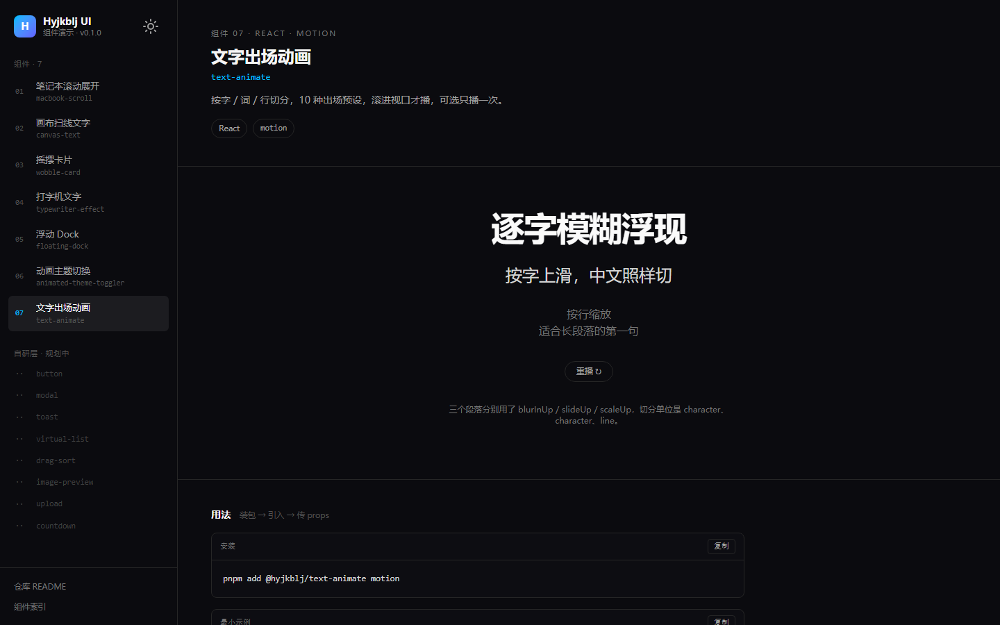
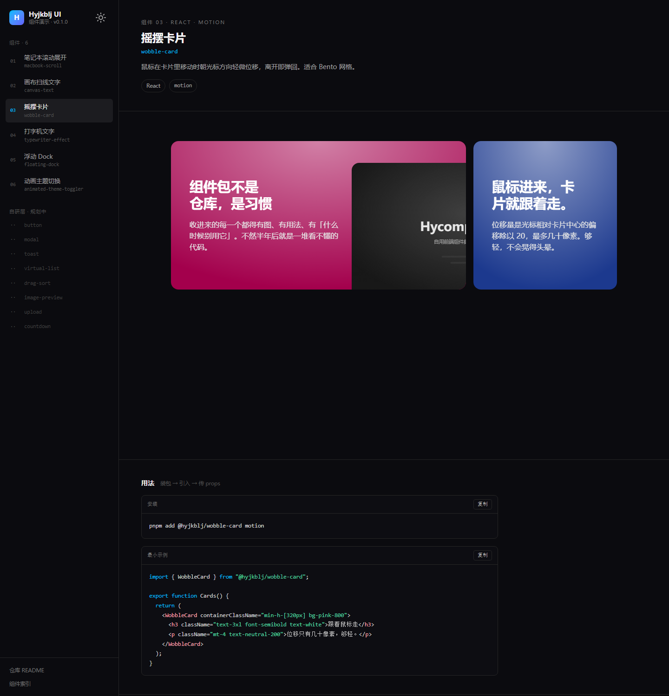
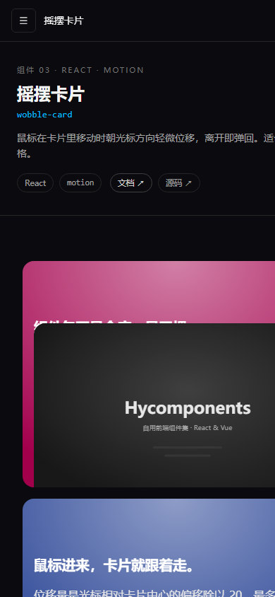

<div align="center">

# Hyjkblj UI

**React 组件集 · 一个组件一个包 · 每个组件一份带效果图的文档**


[组件索引](docs/COMPONENTS.md) · [贡献指南](docs/CONTRIBUTING.md) · [问题反馈](https://github.com/Hyjkblj/hyjkbljUI/issues)

</div>

---

## 简介

好用的组件散落在各个项目里，每开一个新项目就要重新找一遍、改一遍、踩一遍同样的坑。这个仓库把它们收在一处，并且**收进来就写清楚**。

一个组件能进这里，要满足三条：

- 在真实项目里用过，下次还想用
- 文档能让半年后的自己不用问人就能用起来
- 有效果图，有能跑的 demo

## 特性

- **一包一组件** — `@hyjkblj/macbook-scroll`、`@hyjkblj/canvas-text`…… 用哪个装哪个，不用的代码不进产物
- **两条分发路径** — 装包（版本化、可升级），或直接复制源码（能改）
- **依赖透明** — 每个包在 `peerDependencies` 里声明依赖，文档写清它值不值这个体积
- **八节文档** — 效果 / 安装 / 用法 / API / 样式 / 注意事项 / 变更记录 / 出处，缺一节不算收录
- **可交互演示** — 所有组件挂在同一个 playground，`?only=<name>` 可单独查看

## 组件

| 组件 | 包名 | 依赖 | 说明 |
| --- | --- | --- | --- |
| [MacbookScroll](registry/macbook-scroll/README.md) | `@hyjkblj/macbook-scroll` | motion, @tabler/icons-react | 滚动驱动的笔记本开盖动效 |
| [CanvasText](registry/canvas-text/README.md) | `@hyjkblj/canvas-text` | 无 | 文字抠成彩色扫线 |
| [WobbleCard](registry/wobble-card/README.md) | `@hyjkblj/wobble-card` | motion | 跟随鼠标轻微位移的卡片 |
| [TypewriterEffect](registry/typewriter-effect/README.md) | `@hyjkblj/typewriter-effect` | motion | 打字机文字，两个版本 |
| [FloatingDock](registry/floating-dock/README.md) | `@hyjkblj/floating-dock` | motion, @tabler/icons-react | macOS 风格 Dock |
| [AnimatedThemeToggler](registry/animated-theme-toggler/README.md) | `@hyjkblj/animated-theme-toggler` | lucide-react | 形变动画的主题切换 |
| [TextAnimate](registry/text-animate/README.md) | `@hyjkblj/text-animate` | motion | 逐字 / 逐词 / 逐行的文字动画 |
| [Skeleton](registry/skeleton/README.md) | `@hyjkblj/skeleton` | 无 | 扫光式骨架屏 |
| [FloatingPanel](registry/floating-panel/README.md) | `@hyjkblj/floating-panel` | motion, lucide-react | 从按钮位置展开的浮动面板 |
| [Select](registry/select/README.md) | `@hyjkblj/select` | motion, lucide-react | 动画下拉选择 + morph 变体 |

完整索引（效果图 + 源码链接 + 本地演示方式）：**[docs/COMPONENTS.md](docs/COMPONENTS.md)**

## 快速开始

### 环境要求

Node.js >= 20.19 · pnpm >= 9

### 安装

> **包尚未发布到 npm。** 现在有两种可用方式：

```bash
# 方式一：源码复制（最省事，能直接改）
cp registry/canvas-text/canvas-text.tsx src/components/ui/

# 方式二：本地 file: 引用（保留包结构）
pnpm add file:../HyjkbljUI/registry/canvas-text
```

发布到 npm 后即可 `pnpm add @hyjkblj/canvas-text`。

### 配置 Tailwind（v4 必读）

组件类名写在包的产物里，Tailwind v4 的自动扫描找不到它。**漏了这一步，组件会看起来完全没有样式。**

```css
@import "tailwindcss";
@source "../node_modules/@hyjkblj";
```

### 使用

```tsx
import { CanvasText } from "@hyjkblj/canvas-text";

export function Hero() {
  return (
    <h1 className="text-6xl font-bold">
      Ship faster at{" "}
      <CanvasText
        text="Lightning Speed"
        backgroundClassName="bg-white dark:bg-neutral-950"
        colors={["#38bdf8", "#0ea5e9", "#0284c7"]}
      />
    </h1>
  );
}
```

## 本地开发

```bash
pnpm install

pnpm dev            # 演示站 → http://localhost:5173
pnpm build:pkgs     # 构建全部组件包
pnpm build          # 组件包 + 演示站
```

演示站是「侧栏 + 主区」的文档站结构：左边选组件，右边看效果，**用法与源码直接内联在同一个页面里**，不用跳转到 GitHub。



每个组件页从上到下：**效果 → 用法（安装 + 最小示例）→ 源码（可复制、可滚动）**。



两种直达方式：

```text
http://localhost:5173/#/canvas-text       # 侧栏 + 该组件
http://localhost:5173/?only=canvas-text   # 只有该组件，无外壳（截图用）
```

窄屏自动收成顶栏 + 抽屉：



## 目录结构

```text
HyjkbljUI/
├── registry/                  # 组件源码，同时是 npm 包
│   └── canvas-text/
│       ├── canvas-text.tsx    # 源码（保留出处头注释）
│       ├── package.json       # @hyjkblj/canvas-text
│       ├── dist/              # 构建产物：ESM + d.ts（不入库）
│       └── README.md          # 组件文档（八节）
├── packages/                  # 自研双框架组件（规划中）
├── playground/                # 演示站：Vite + React + Tailwind v4
├── docs/
│   ├── COMPONENTS.md          # 组件索引
│   ├── CONTRIBUTING.md        # 贡献指南
│   └── images/                # 效果图
├── shims/cn.ts                # 构建期把 @/lib/utils 指向这里
├── tsup.config.ts             # 一条命令构建所有包
├── registry.json              # shadcn registry 索引（复制式分发）
└── pnpm-workspace.yaml
```

## 构建与发布

```bash
pnpm build:pkgs                                # 构建全部包（prepublishOnly 也会自动跑）
pnpm --filter @hyjkblj/canvas-text publish     # 发布单个包
```

每个包独立版本，不做统一大版本。`experimental` 阶段允许 breaking change，但必须写进组件文档的变更记录。

## 技术栈

| 项 | 选择 |
| --- | --- |
| 包管理 | pnpm workspace |
| 语言 | TypeScript（props 类型即文档） |
| 构建 | tsup → ESM + `.d.ts` |
| 演示站 | Vite + React 19 + Tailwind CSS v4 |
| 分发 | npm scope `@hyjkblj` + shadcn registry |
| 测试 | Vitest + Testing Library（规划中） |

## 设计原则

| # | 原则 | 含义 |
| --- | --- | --- |
| 1 | **一包一组件** | 一个目录只放一个组件，不做大而全的集合包 |
| 2 | **框架显式声明** | 支持哪些框架必须写明，不许含糊 |
| 3 | **效果先行** | 文档先给能看的东西，再给用法 |
| 4 | **依赖透明** | 引入什么、为什么值这个体积，必须写清楚 |
| 5 | **样式可控** | 说清楚"想改成我的样子要动哪里" |

## 常见问题

**Q：装上之后完全没有样式？**
Tailwind v4 没有扫描到包的产物。在入口 CSS 加 `@source "../node_modules/@hyjkblj";`。

**Q：提示缺 `motion` / `@tabler/icons-react`？**
它们声明在 `peerDependencies` 里，需要由你的项目安装。按安装时的提示补上即可。

**Q：装包还是复制源码？**
想跟着上游升级、多个项目共用 → 装包。想直接改组件本身、或项目里没有 Tailwind → 复制源码。

**Q：为什么有的组件依赖很重？**
每个组件文档的「注意事项」都写了它的依赖是否值得。例如 `wobble-card` 的 `motion` 其实可以拆掉。

## 贡献

新增组件、文档规范、效果图流程见 **[docs/CONTRIBUTING.md](docs/CONTRIBUTING.md)**。

## License

[MIT](LICENSE) · 收录组件的版权归原作者，详见各组件文档的「出处」一节。
