# 组件索引

> [← 返回 README](../README.md) · [贡献指南](CONTRIBUTING.md)

每个组件一份独立文档，固定八节：**效果 → 安装 → 用法 → API → 样式 → 注意事项 → 变更记录 → 出处**。
点组件名或效果图直接进文档。

## 速查表

| # | 组件 | 包名 | 框架 | 依赖 | 状态 | 文档 |
| --- | --- | --- | --- | --- | --- | --- |
| 01 | MacbookScroll 笔记本滚动 | `@hyjkblj/macbook-scroll` | React | motion, @tabler/icons-react | experimental | [文档](../registry/macbook-scroll/README.md) |
| 02 | CanvasText 画布扫线文字 | `@hyjkblj/canvas-text` | React | 无 | experimental | [文档](../registry/canvas-text/README.md) |
| 03 | WobbleCard 摇摆卡片 | `@hyjkblj/wobble-card` | React | motion（可拆） | experimental | [文档](../registry/wobble-card/README.md) |
| 04 | TypewriterEffect 打字机 | `@hyjkblj/typewriter-effect` | React | motion | experimental | [文档](../registry/typewriter-effect/README.md) |
| 05 | FloatingDock 浮动 Dock | `@hyjkblj/floating-dock` | React | motion, @tabler/icons-react | experimental | [文档](../registry/floating-dock/README.md) |
| 06 | AnimatedThemeToggler 动画主题切换 | `@hyjkblj/animated-theme-toggler` | React | lucide-react | experimental | [文档](../registry/animated-theme-toggler/README.md) |
| 07 | TextAnimate 文字出场动画 | `@hyjkblj/text-animate` | React | motion | experimental | [文档](../registry/text-animate/README.md) |
| 08 | Skeleton 骨架屏 | `@hyjkblj/skeleton` | React | 无 | experimental | [文档](../registry/skeleton/README.md) |
| 09 | FloatingPanel 浮动面板 | `@hyjkblj/floating-panel` | React | motion, lucide-react | experimental | [文档](../registry/floating-panel/README.md) |
| 10 | Select 动画下拉选择 | `@hyjkblj/select` | React | motion, lucide-react | experimental | [文档](../registry/select/README.md) |
| 11 | ExpandableActionBar 可展开工具条 | `@hyjkblj/expandable-action-bar` | React | motion, lucide-react | experimental | [文档](../registry/expandable-action-bar/README.md) |
| 12 | MorphingSearch 形变搜索 | `@hyjkblj/morphing-search` | React | motion, lucide-react | experimental | [文档](../registry/morphing-search/README.md) |
| 13 | OverflowActions 溢出操作条 | `@hyjkblj/overflow-actions` | React | motion, lucide-react | experimental | [文档](../registry/overflow-actions/README.md) |
| 14 | HeroVideoDialog 视频弹窗 | `@hyjkblj/hero-video-dialog` | React | motion, lucide-react | experimental | [文档](../registry/hero-video-dialog/README.md) |
| 15 | LiquidGlass 液态玻璃 | `@hyjkblj/liquid-glass` | React | 无 | experimental | [文档](../registry/liquid-glass/README.md) |
| 16 | MergingBubbles 融合气泡 | `@hyjkblj/merging-bubbles` | React | 无 | experimental | [文档](../registry/merging-bubbles/README.md) |
| 17 | AppleProDisplayXDR 显示器 | `@hyjkblj/apple-pro-display-xdr` | React | motion, @tabler/icons-react | experimental | [文档](../registry/apple-pro-display-xdr/README.md) |
| 18 | ImagesBadge 图片堆徽章 | `@hyjkblj/images-badge` | React | motion | experimental | [文档](../registry/images-badge/README.md) |
| 19 | MagneticButton 磁吸按钮 | `@hyjkblj/button-magnetic` | React | motion, lucide-react | experimental | [文档](../registry/button-magnetic/README.md) |
| 20 | StatefulButton 状态按钮 | `@hyjkblj/button-stateful` | React | motion, lucide-react | experimental | [文档](../registry/button-stateful/README.md) |

**状态说明**：`experimental` → 能用，API 可能变；`stable` → 推荐使用；`deprecated` → 准备移除。

---

## 01 · MacbookScroll 笔记本滚动

页面往下滚，一台 MacBook 从合盖倾斜的状态慢慢「开盖」转正，屏幕里的内容随之展开。适合首屏到正文的过渡。

| 项 | 值 |
| --- | --- |
| 包名 | `@hyjkblj/macbook-scroll` |
| 框架 / 状态 | React · experimental |
| 依赖 | `motion`、`@tabler/icons-react` |
| 安装 | `pnpm add @hyjkblj/macbook-scroll` |
| 文档 | [registry/macbook-scroll/README.md](../registry/macbook-scroll/README.md) |
| 源码 | [macbook-scroll.tsx](../registry/macbook-scroll/macbook-scroll.tsx) |
| 效果图 | [docs/images/macbook-scroll.png](images/macbook-scroll.png) |
| 本地演示 | `pnpm dev` 后打开 `#/macbook-scroll`；截图用 `?only=macbook-scroll` |

---

## 02 · CanvasText 画布扫线文字

[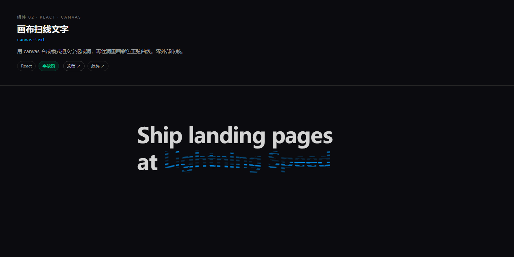](../registry/canvas-text/README.md)

把文字变成「从彩色扫描线里挖出来的洞」：canvas 用背景色填出字形，再在字形范围内画一层正弦偏移的横向曲线。**零外部依赖**。

| 项 | 值 |
| --- | --- |
| 包名 | `@hyjkblj/canvas-text` |
| 框架 / 状态 | React · experimental |
| 依赖 | 无（只需 `react` 与包内自带的 `cn`） |
| 安装 | `pnpm add @hyjkblj/canvas-text` |
| 文档 | [registry/canvas-text/README.md](../registry/canvas-text/README.md) |
| 源码 | [canvas-text.tsx](../registry/canvas-text/canvas-text.tsx) |
| 效果图 | [docs/images/canvas-text.png](images/canvas-text.png) |
| 本地演示 | `pnpm dev` 后打开 `#/canvas-text`；截图用 `?only=canvas-text` |

---

## 03 · WobbleCard 摇摆卡片

[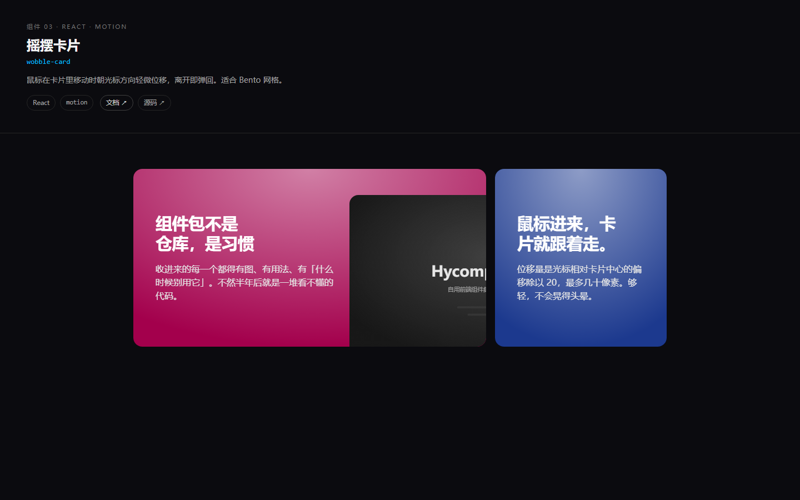](../registry/wobble-card/README.md)

鼠标在卡片里移动时，卡片朝光标方向轻微位移，离开即弹回。位移只有几十像素，用来做 Bento 网格那种「活的」感觉。

| 项 | 值 |
| --- | --- |
| 包名 | `@hyjkblj/wobble-card` |
| 框架 / 状态 | React · experimental |
| 依赖 | `motion`（实际可拆掉，见文档注意事项） |
| 安装 | `pnpm add @hyjkblj/wobble-card` |
| 文档 | [registry/wobble-card/README.md](../registry/wobble-card/README.md) |
| 源码 | [wobble-card.tsx](../registry/wobble-card/wobble-card.tsx) |
| 效果图 | [docs/images/wobble-card.png](images/wobble-card.png) |
| 本地演示 | `pnpm dev` 后打开 `#/wobble-card`；截图用 `?only=wobble-card` |

---

## 04 · TypewriterEffect 打字机

[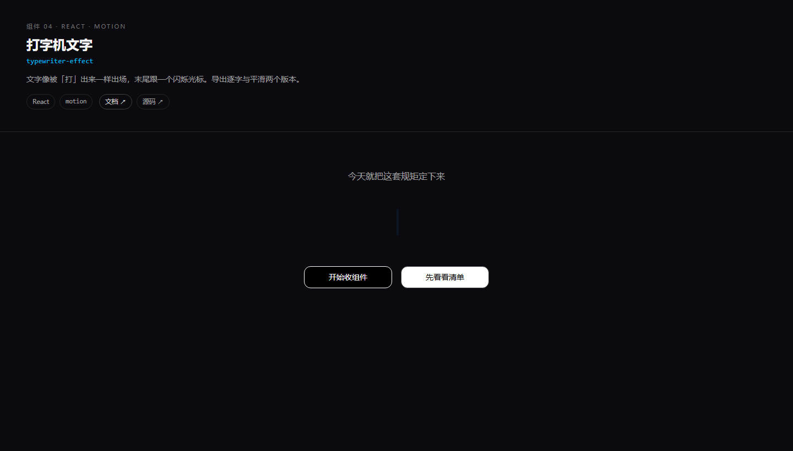](../registry/typewriter-effect/README.md)

文字像被「打」出来一样出场，末尾跟一个闪烁光标。导出两个版本：`TypewriterEffect` 逐字符真打字，`TypewriterEffectSmooth` 容器宽度一次性擦除。

| 项 | 值 |
| --- | --- |
| 包名 | `@hyjkblj/typewriter-effect` |
| 框架 / 状态 | React · experimental |
| 依赖 | `motion` |
| 安装 | `pnpm add @hyjkblj/typewriter-effect` |
| 文档 | [registry/typewriter-effect/README.md](../registry/typewriter-effect/README.md) |
| 源码 | [typewriter-effect.tsx](../registry/typewriter-effect/typewriter-effect.tsx) |
| 效果图 | [docs/images/typewriter-effect.png](images/typewriter-effect.png) |
| 本地演示 | `pnpm dev` 后打开 `#/typewriter-effect`；截图用 `?only=typewriter-effect` |

---

## 05 · FloatingDock 浮动 Dock

[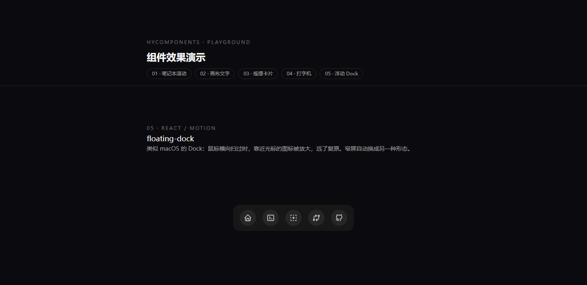](../registry/floating-dock/README.md)

macOS 那种 Dock：鼠标横向扫过时，离光标最近的图标被弹簧放大；窄屏自动换成右下角圆按钮 + 向上弹出。

| 项 | 值 |
| --- | --- |
| 包名 | `@hyjkblj/floating-dock` |
| 框架 / 状态 | React · experimental |
| 依赖 | `motion`、`@tabler/icons-react` |
| 安装 | `pnpm add @hyjkblj/floating-dock` |
| 文档 | [registry/floating-dock/README.md](../registry/floating-dock/README.md) |
| 源码 | [floating-dock.tsx](../registry/floating-dock/floating-dock.tsx) |
| 效果图 | [docs/images/floating-dock.png](images/floating-dock.png) |
| 本地演示 | `pnpm dev` 后打开 `#/floating-dock`；截图用 `?only=floating-dock` |

---

## 06 · AnimatedThemeToggler 动画主题切换

[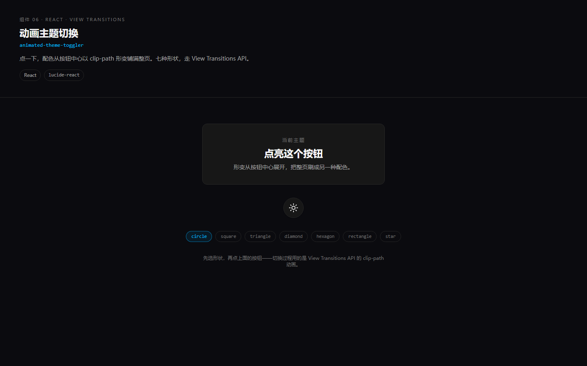](../registry/animated-theme-toggler/README.md)

点一下，新主题以 clip-path 形变从按钮中心铺满视口。七种形状，走浏览器原生 View Transitions API。

| 项 | 值 |
| --- | --- |
| 包名 | `@hyjkblj/animated-theme-toggler` |
| 框架 / 状态 | React · experimental |
| 依赖 | `lucide-react` |
| 安装 | `pnpm add @hyjkblj/animated-theme-toggler lucide-react` |
| 文档 | [registry/animated-theme-toggler/README.md](../registry/animated-theme-toggler/README.md) |
| 源码 | [animated-theme-toggler.tsx](../registry/animated-theme-toggler/animated-theme-toggler.tsx) |
| 效果图 | [docs/images/animated-theme-toggler.png](images/animated-theme-toggler.png) |
| 本地演示 | `pnpm dev` 后打开 `#/animated-theme-toggler`；截图用 `?only=animated-theme-toggler` |

---

## 07 · TextAnimate 文字出场动画

[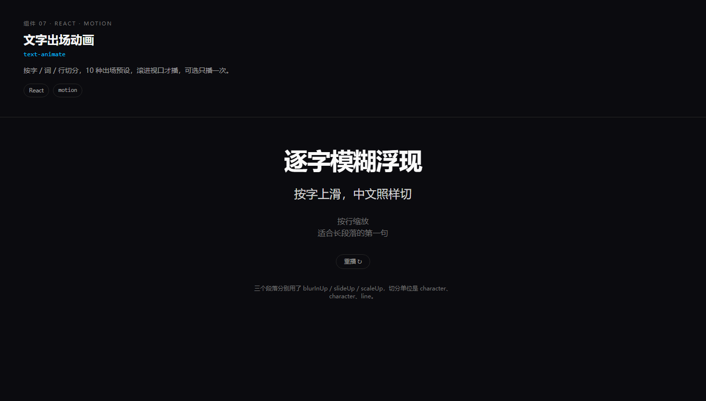](../registry/text-animate/README.md)

按字 / 词 / 行切分，10 种出场预设（模糊、位移、缩放）。滚进视口才播，可设只播一次。

| 项 | 值 |
| --- | --- |
| 包名 | `@hyjkblj/text-animate` |
| 框架 / 状态 | React · experimental |
| 依赖 | `motion` |
| 安装 | `pnpm add @hyjkblj/text-animate motion` |
| 文档 | [registry/text-animate/README.md](../registry/text-animate/README.md) |
| 源码 | [text-animate.tsx](../registry/text-animate/text-animate.tsx) |
| 效果图 | [docs/images/text-animate.png](images/text-animate.png) |
| 本地演示 | `pnpm dev` 后打开 `#/text-animate`；截图用 `?only=text-animate` |

---

## 08 · Skeleton 骨架屏

[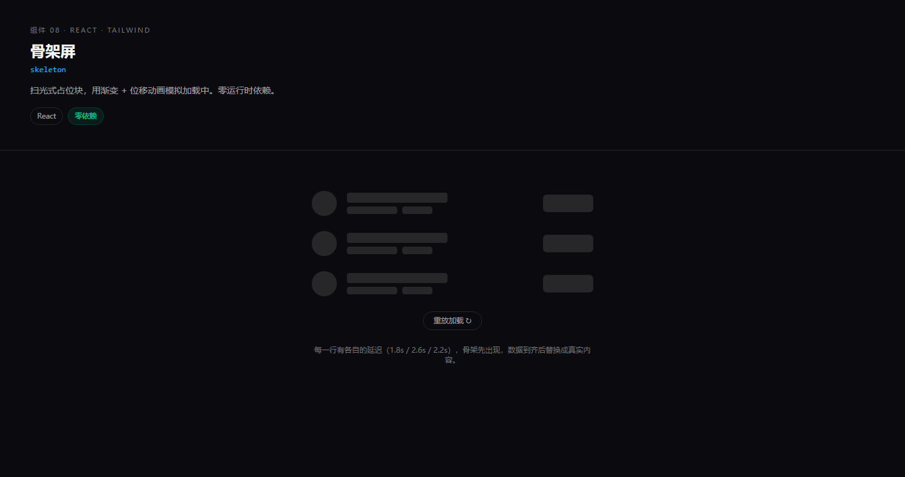](../registry/skeleton/README.md)

加载中的占位块：`--color-muted` 底色上一条高光从左往右扫。比 `animate-pulse` 更有方向感。

| 项 | 值 |
| --- | --- |
| 包名 | `@hyjkblj/skeleton` |
| 框架 / 状态 | React · experimental |
| 依赖 | 无（需 Tailwind v4 的 `--color-muted` 与 `--animate-skeleton`） |
| 安装 | `pnpm add @hyjkblj/skeleton` |
| 文档 | [registry/skeleton/README.md](../registry/skeleton/README.md) |
| 源码 | [skeleton.tsx](../registry/skeleton/skeleton.tsx) |
| 效果图 | [docs/images/skeleton.png](images/skeleton.png) |
| 本地演示 | `pnpm dev` 后打开 `#/skeleton`；截图用 `?only=skeleton` |

---

## 09 · FloatingPanel 浮动面板

[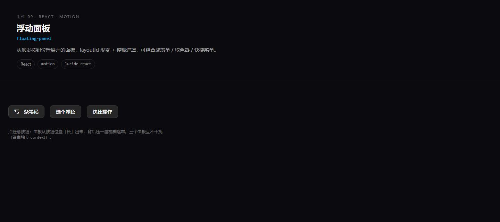](../registry/floating-panel/README.md)

从触发按钮位置展开的面板：按钮经 `layoutId` 形变成标题栏，背景压一层模糊遮罩。12 个组合件，能拼表单 / 取色器 / 快捷菜单。

| 项 | 值 |
| --- | --- |
| 包名 | `@hyjkblj/floating-panel` |
| 框架 / 状态 | React · experimental |
| 依赖 | `motion`、`lucide-react` |
| 安装 | `pnpm add @hyjkblj/floating-panel motion lucide-react` |
| 文档 | [registry/floating-panel/README.md](../registry/floating-panel/README.md) |
| 源码 | [floating-panel.tsx](../registry/floating-panel/floating-panel.tsx) |
| 效果图 | [docs/images/floating-panel.png](images/floating-panel.png) |
| 本地演示 | `pnpm dev` 后打开 `#/floating-panel`；截图用 `?only=floating-panel` |

---

## 10 · Select 动画下拉选择

[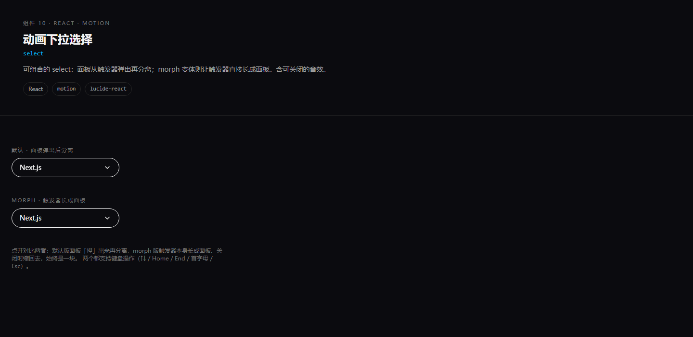](../registry/select/README.md)

面板从触发器弹出再分离；morph 变体让触发器直接长成面板。17 个文件的可组合件，含可选音效引擎。

| 项 | 值 |
| --- | --- |
| 包名 | `@hyjkblj/select`（morph 走 `/morph` 子路径） |
| 框架 / 状态 | React · experimental |
| 依赖 | `motion`、`lucide-react` |
| 安装 | `pnpm add @hyjkblj/select motion lucide-react` |
| 文档 | [registry/select/README.md](../registry/select/README.md) |
| 源码 | [select.tsx](../registry/select/select.tsx) · [select-morph.tsx](../registry/select/select-morph.tsx) |
| 效果图 | [docs/images/select.png](images/select.png) |
| 本地演示 | `pnpm dev` 后打开 `#/select`；截图用 `?only=select` |

---

## 11 · ExpandableActionBar 可展开工具条

[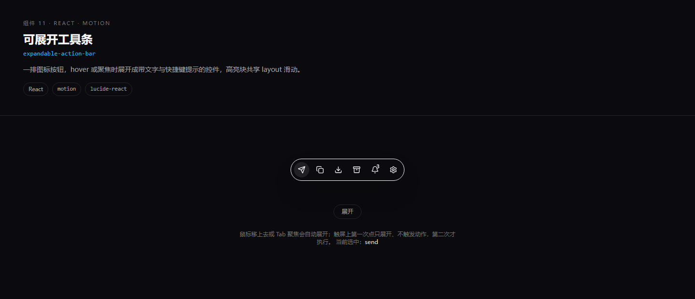](../registry/expandable-action-bar/README.md)

一排图标，hover 或聚焦展开成带文字与快捷键提示的控件，高亮块共享 layout 滑动。

| 项 | 值 |
| --- | --- |
| 包名 | `@hyjkblj/expandable-action-bar` |
| 框架 / 状态 | React · experimental |
| 依赖 | `motion`、`lucide-react` |
| 安装 | `pnpm add @hyjkblj/expandable-action-bar motion lucide-react` |
| 文档 | [registry/expandable-action-bar/README.md](../registry/expandable-action-bar/README.md) |
| 源码 | [expandable-action-bar.tsx](../registry/expandable-action-bar/expandable-action-bar.tsx) |
| 效果图 | [docs/images/expandable-action-bar.png](images/expandable-action-bar.png) |
| 本地演示 | `pnpm dev` 后打开 `#/expandable-action-bar`；截图用 `?only=expandable-action-bar` |

---

## 12 · MorphingSearch 形变搜索

[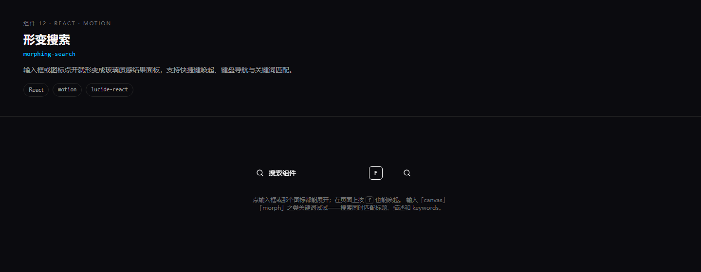](../registry/morphing-search/README.md)

输入框或图标点开后形变成玻璃结果面板，支持快捷键唤起、键盘导航与关键词匹配。

| 项 | 值 |
| --- | --- |
| 包名 | `@hyjkblj/morphing-search` |
| 框架 / 状态 | React · experimental |
| 依赖 | `motion`、`lucide-react` |
| 安装 | `pnpm add @hyjkblj/morphing-search motion lucide-react` |
| 文档 | [registry/morphing-search/README.md](../registry/morphing-search/README.md) |
| 源码 | [morphing-search.tsx](../registry/morphing-search/morphing-search.tsx) |
| 效果图 | [docs/images/morphing-search.png](images/morphing-search.png) |
| 本地演示 | `pnpm dev` 后打开 `#/morphing-search`；截图用 `?only=morphing-search` |

---

## 13 · OverflowActions 溢出操作条

[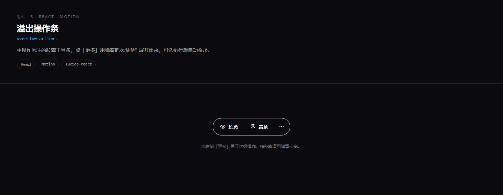](../registry/overflow-actions/README.md)

主操作常驻的连体胶囊工具条，点「⋯」用弹簧把次级操作展开出来，可选执行后自动收起。

| 项 | 值 |
| --- | --- |
| 包名 | `@hyjkblj/overflow-actions` |
| 框架 / 状态 | React · experimental |
| 依赖 | `motion`、`lucide-react` |
| 安装 | `pnpm add @hyjkblj/overflow-actions motion lucide-react` |
| 文档 | [registry/overflow-actions/README.md](../registry/overflow-actions/README.md) |
| 源码 | [overflow-actions.tsx](../registry/overflow-actions/overflow-actions.tsx) |
| 效果图 | [docs/images/overflow-actions.png](images/overflow-actions.png) |
| 本地演示 | `pnpm dev` 后打开 `#/overflow-actions`；截图用 `?only=overflow-actions` |

---

## 14 · HeroVideoDialog 视频弹窗

[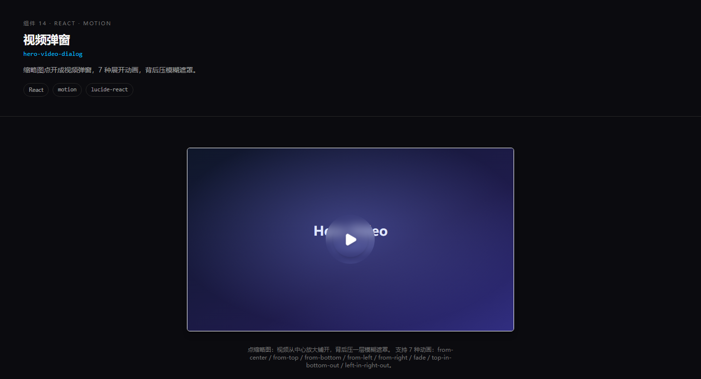](../registry/hero-video-dialog/README.md)

缩略图上盖个播放按钮，点开视频从指定方向放大铺满视口，背后压模糊遮罩。8 种展开方向。

| 项 | 值 |
| --- | --- |
| 包名 | `@hyjkblj/hero-video-dialog` |
| 框架 / 状态 | React · experimental |
| 依赖 | `motion`、`lucide-react` |
| 安装 | `pnpm add @hyjkblj/hero-video-dialog motion lucide-react` |
| 文档 | [registry/hero-video-dialog/README.md](../registry/hero-video-dialog/README.md) |
| 源码 | [hero-video-dialog.tsx](../registry/hero-video-dialog/hero-video-dialog.tsx) |
| 效果图 | [docs/images/hero-video-dialog.png](images/hero-video-dialog.png) |
| 本地演示 | `pnpm dev` 后打开 `#/hero-video-dialog`；截图用 `?only=hero-video-dialog` |

---

## 15 · LiquidGlass 液态玻璃

[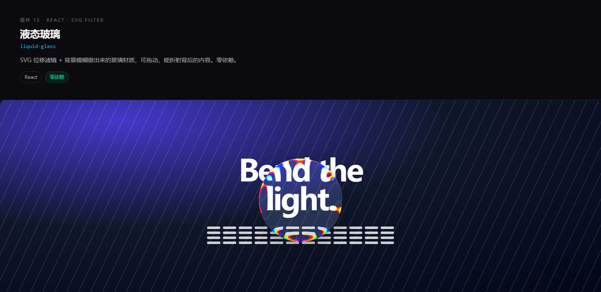](../registry/liquid-glass/README.md)

SVG 位移滤镜做成的玻璃：折射背后内容，边缘带色散。仅 Chromium 真折射，其它浏览器降级成磨砂玻璃。零依赖。

| 项 | 值 |
| --- | --- |
| 包名 | `@hyjkblj/liquid-glass` |
| 框架 / 状态 | React · experimental |
| 依赖 | 无 |
| 安装 | `pnpm add @hyjkblj/liquid-glass` |
| 文档 | [registry/liquid-glass/README.md](../registry/liquid-glass/README.md) |
| 源码 | [liquid-glass.tsx](../registry/liquid-glass/liquid-glass.tsx) |
| 效果图 | [docs/images/liquid-glass.png](images/liquid-glass.png) |
| 本地演示 | `pnpm dev` 后打开 `#/liquid-glass`；截图用 `?only=liquid-glass` |

---

## 16 · MergingBubbles 融合气泡

[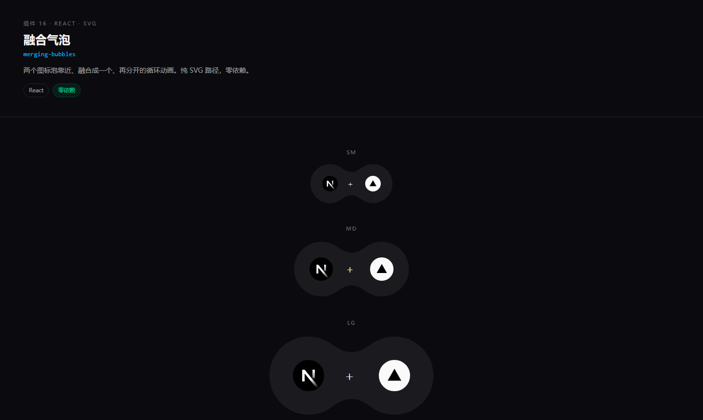](../registry/merging-bubbles/README.md)

两个图标泡用融合轮廓连成一体，中间可选加号。**静态图形，源码里没有动画**。

| 项 | 值 |
| --- | --- |
| 包名 | `@hyjkblj/merging-bubbles` |
| 框架 / 状态 | React · experimental |
| 依赖 | 无（需要 shadcn 的 `foreground` / `muted` 语义色） |
| 安装 | `pnpm add @hyjkblj/merging-bubbles` |
| 文档 | [registry/merging-bubbles/README.md](../registry/merging-bubbles/README.md) |
| 源码 | [merging-bubbles.tsx](../registry/merging-bubbles/merging-bubbles.tsx) |
| 效果图 | [docs/images/merging-bubbles.png](images/merging-bubbles.png) |
| 本地演示 | `pnpm dev` 后打开 `#/merging-bubbles`；截图用 `?only=merging-bubbles` |

---

## 17 · AppleProDisplayXDR 显示器

[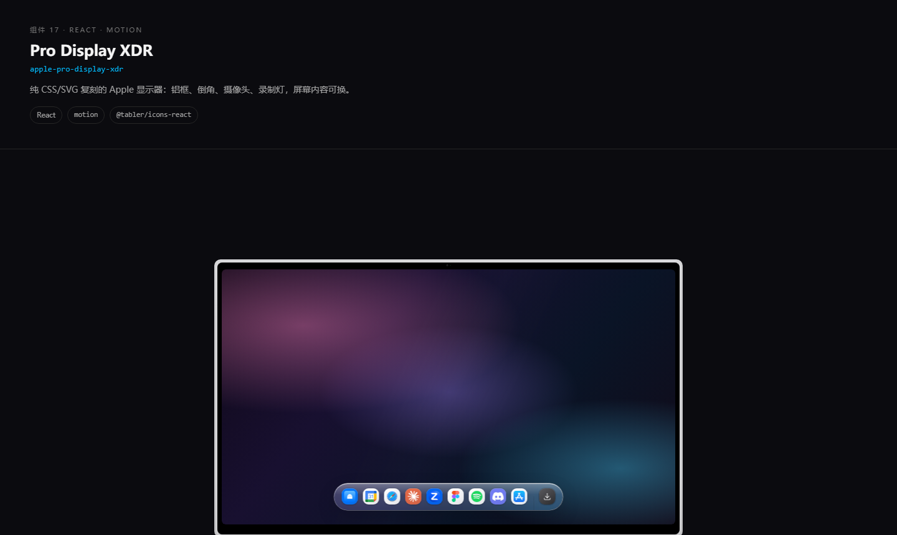](../registry/apple-pro-display-xdr/README.md)

纯 CSS/SVG 复刻的 Pro Display XDR：铝框、倒角、摄像头、录制灯、支架，屏幕内容四选一或完全自定义。

| 项 | 值 |
| --- | --- |
| 包名 | `@hyjkblj/apple-pro-display-xdr` |
| 框架 / 状态 | React · experimental |
| 依赖 | `motion`、`@tabler/icons-react`（next/image 与 base-ui Tooltip 已换成本地替身） |
| 安装 | `pnpm add @hyjkblj/apple-pro-display-xdr motion @tabler/icons-react` |
| 文档 | [registry/apple-pro-display-xdr/README.md](../registry/apple-pro-display-xdr/README.md) |
| 源码 | [apple-pro-display-xdr.tsx](../registry/apple-pro-display-xdr/apple-pro-display-xdr.tsx) |
| 效果图 | [docs/images/apple-pro-display-xdr.png](images/apple-pro-display-xdr.png) |
| 本地演示 | `pnpm dev` 后打开 `#/apple-pro-display-xdr`；截图用 `?only=apple-pro-display-xdr` |

---

## 18 · ImagesBadge 图片堆徽章

[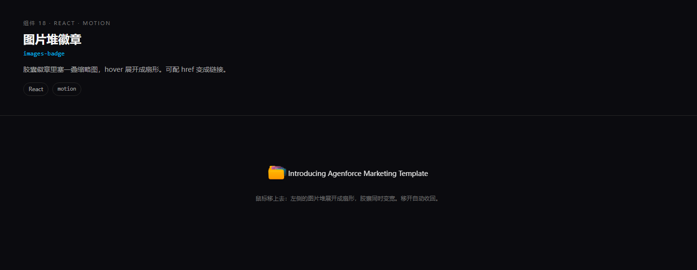](../registry/images-badge/README.md)

胶囊徽章里叠一摞缩略图，hover 展开成扇形、胶囊变宽。可传 href 变成链接。

| 项 | 值 |
| --- | --- |
| 包名 | `@hyjkblj/images-badge` |
| 框架 / 状态 | React · experimental |
| 依赖 | `motion` |
| 安装 | `pnpm add @hyjkblj/images-badge motion` |
| 文档 | [registry/images-badge/README.md](../registry/images-badge/README.md) |
| 源码 | [images-badge.tsx](../registry/images-badge/images-badge.tsx) |
| 效果图 | [docs/images/images-badge.png](images/images-badge.png) |
| 本地演示 | `pnpm dev` 后打开 `#/images-badge`；截图用 `?only=images-badge` |

---

## 19 · MagneticButton 磁吸按钮

[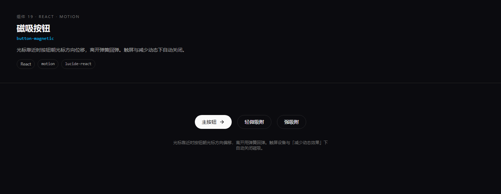](../registry/button-magnetic/README.md)

光标靠近时按钮朝光标位移，离开用弹簧回弹。触屏与减少动态下自动关闭。

| 项 | 值 |
| --- | --- |
| 包名 | `@hyjkblj/button-magnetic` |
| 框架 / 状态 | React · experimental |
| 依赖 | `motion`、`lucide-react`（需 shadcn 语义色变量） |
| 安装 | `pnpm add @hyjkblj/button-magnetic motion lucide-react` |
| 文档 | [registry/button-magnetic/README.md](../registry/button-magnetic/README.md) |
| 源码 | [button/magnetic.tsx](../registry/button-magnetic/button/magnetic.tsx) |
| 效果图 | [docs/images/button-magnetic.png](images/button-magnetic.png) |
| 本地演示 | `pnpm dev` 后打开 `#/button-magnetic`；截图用 `?only=button-magnetic` |

---

## 20 · StatefulButton 状态按钮

[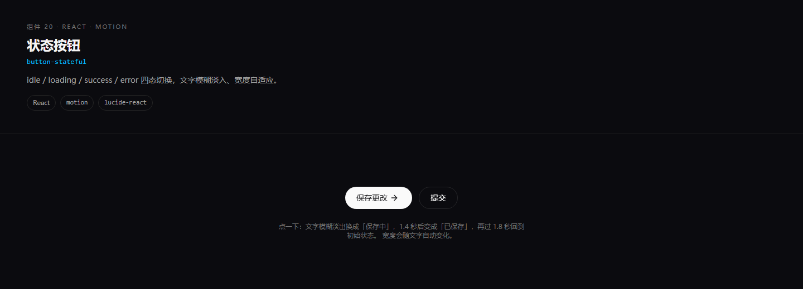](../registry/button-stateful/README.md)

idle / loading / success / error 四态切换，文字模糊淡入、宽度自适应，loading 时自动禁用。

| 项 | 值 |
| --- | --- |
| 包名 | `@hyjkblj/button-stateful` |
| 框架 / 状态 | React · experimental |
| 依赖 | `motion`、`lucide-react`（需 shadcn 语义色） |
| 安装 | `pnpm add @hyjkblj/button-stateful motion lucide-react` |
| 文档 | [registry/button-stateful/README.md](../registry/button-stateful/README.md) |
| 源码 | [button/stateful.tsx](../registry/button-stateful/button/stateful.tsx) |
| 效果图 | [docs/images/button-stateful.png](images/button-stateful.png) |
| 本地演示 | `pnpm dev` 后打开 `#/button-stateful`；截图用 `?only=button-stateful` |

---

## 自研层（规划中）

还没开始，包名预留 `@hyjkblj/<name>`。做完一个就挪到上面的索引里。

| 组件 | 目标包名 | 框架 | 一句话说明 |
| --- | --- | --- | --- |
| Button 按钮 | `@hyjkblj/button` | React + Vue | 基础按钮，多形态与加载态 |
| Modal 弹窗 | `@hyjkblj/modal` | React + Vue | 命令式 + 声明式两种调用 |
| Toast 轻提示 | `@hyjkblj/toast` | React + Vue | 全局提示，队列与去重 |
| VirtualList 虚拟列表 | `@hyjkblj/virtual-list` | React + Vue | 大数据量，固定/动态行高 |
| DragSort 拖拽排序 | `@hyjkblj/drag-sort` | React + Vue | 原生拖拽，横纵向 |
| ImagePreview 图片预览 | `@hyjkblj/image-preview` | React + Vue | 缩放、旋转、多图 |
| Upload 上传 | `@hyjkblj/upload` | React + Vue | 拖拽上传、进度、重试 |
| Countdown 倒计时 | `@hyjkblj/countdown` | React + Vue | 秒级精度，防后台节流 |

---

> 这份索引是活的。做完一个就改状态；新想法先进「候选池」，别直接进表。
> **候选池**：暂无。
