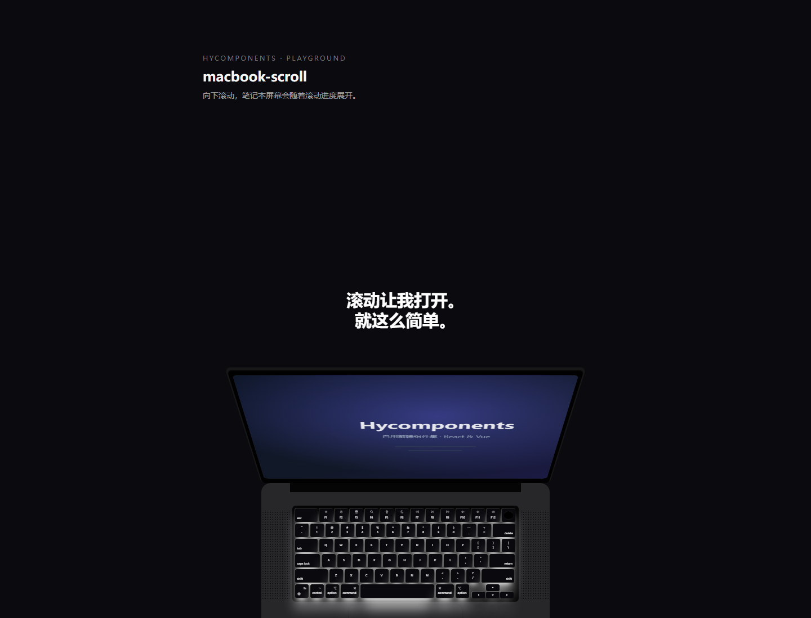

# 组件索引

> [← 返回 README](../README.md) · [贡献指南](CONTRIBUTING.md)

每个组件一份独立文档，固定八节：**效果 → 安装 → 用法 → API → 样式 → 注意事项 → 变更记录 → 出处**。
点组件名或效果图直接进文档。

## 速查表

| # | 组件 | 包名 | 框架 | 依赖 | 状态 | 文档 |
| --- | --- | --- | --- | --- | --- | --- |
| 01 | MacbookScroll 笔记本滚动 | `@hyjkblj/macbook-scroll` | React | motion, @tabler/icons-react | experimental | [文档](../registry/macbook-scroll/README.md) |
| 02 | CanvasText 画布扫线文字 | `@hyjkblj/canvas-text` | React | 无 | experimental | [文档](../registry/canvas-text/README.md) |
| 03 | WobbleCard 摇摆卡片 | `@hyjkblj/wobble-card` | React | motion（可拆） | experimental | [文档](../registry/wobble-card/README.md) |
| 04 | TypewriterEffect 打字机 | `@hyjkblj/typewriter-effect` | React | motion | experimental | [文档](../registry/typewriter-effect/README.md) |
| 05 | FloatingDock 浮动 Dock | `@hyjkblj/floating-dock` | React | motion, @tabler/icons-react | experimental | [文档](../registry/floating-dock/README.md) |

**状态说明**：`experimental` → 能用，API 可能变；`stable` → 推荐使用；`deprecated` → 准备移除。

---

## 01 · MacbookScroll 笔记本滚动

页面往下滚，一台 MacBook 从合盖倾斜的状态慢慢「开盖」转正，屏幕里的内容随之展开。适合首屏到正文的过渡。

| 项 | 值 |
| --- | --- |
| 包名 | `@hyjkblj/macbook-scroll` |
| 框架 / 状态 | React · experimental |
| 依赖 | `motion`、`@tabler/icons-react` |
| 安装 | `pnpm add @hyjkblj/macbook-scroll` |
| 文档 | [registry/macbook-scroll/README.md](../registry/macbook-scroll/README.md) |
| 源码 | [macbook-scroll.tsx](../registry/macbook-scroll/macbook-scroll.tsx) |
| 效果图 | [docs/images/macbook-scroll.png](images/macbook-scroll.png) |
| 本地演示 | `pnpm dev` 后访问 `?only=macbook-scroll` |

---

## 02 · CanvasText 画布扫线文字

把文字变成「从彩色扫描线里挖出来的洞」：canvas 用背景色填出字形，再在字形范围内画一层正弦偏移的横向曲线。**零外部依赖**。

| 项 | 值 |
| --- | --- |
| 包名 | `@hyjkblj/canvas-text` |
| 框架 / 状态 | React · experimental |
| 依赖 | 无（只需 `react` 与包内自带的 `cn`） |
| 安装 | `pnpm add @hyjkblj/canvas-text` |
| 文档 | [registry/canvas-text/README.md](../registry/canvas-text/README.md) |
| 源码 | [canvas-text.tsx](../registry/canvas-text/canvas-text.tsx) |
| 效果图 | [docs/images/canvas-text.png](images/canvas-text.png) |
| 本地演示 | `pnpm dev` 后访问 `?only=canvas-text` |

---

## 03 · WobbleCard 摇摆卡片

鼠标在卡片里移动时，卡片朝光标方向轻微位移，离开即弹回。位移只有几十像素，用来做 Bento 网格那种「活的」感觉。

| 项 | 值 |
| --- | --- |
| 包名 | `@hyjkblj/wobble-card` |
| 框架 / 状态 | React · experimental |
| 依赖 | `motion`（实际可拆掉，见文档注意事项） |
| 安装 | `pnpm add @hyjkblj/wobble-card` |
| 文档 | [registry/wobble-card/README.md](../registry/wobble-card/README.md) |
| 源码 | [wobble-card.tsx](../registry/wobble-card/wobble-card.tsx) |
| 效果图 | [docs/images/wobble-card.png](images/wobble-card.png) |
| 本地演示 | `pnpm dev` 后访问 `?only=wobble-card` |

---

## 04 · TypewriterEffect 打字机

文字像被「打」出来一样出场，末尾跟一个闪烁光标。导出两个版本：`TypewriterEffect` 逐字符真打字，`TypewriterEffectSmooth` 容器宽度一次性擦除。

| 项 | 值 |
| --- | --- |
| 包名 | `@hyjkblj/typewriter-effect` |
| 框架 / 状态 | React · experimental |
| 依赖 | `motion` |
| 安装 | `pnpm add @hyjkblj/typewriter-effect` |
| 文档 | [registry/typewriter-effect/README.md](../registry/typewriter-effect/README.md) |
| 源码 | [typewriter-effect.tsx](../registry/typewriter-effect/typewriter-effect.tsx) |
| 效果图 | [docs/images/typewriter-effect.png](images/typewriter-effect.png) |
| 本地演示 | `pnpm dev` 后访问 `?only=typewriter-effect` |

---

## 05 · FloatingDock 浮动 Dock

macOS 那种 Dock：鼠标横向扫过时，离光标最近的图标被弹簧放大；窄屏自动换成右下角圆按钮 + 向上弹出。

| 项 | 值 |
| --- | --- |
| 包名 | `@hyjkblj/floating-dock` |
| 框架 / 状态 | React · experimental |
| 依赖 | `motion`、`@tabler/icons-react` |
| 安装 | `pnpm add @hyjkblj/floating-dock` |
| 文档 | [registry/floating-dock/README.md](../registry/floating-dock/README.md) |
| 源码 | [floating-dock.tsx](../registry/floating-dock/floating-dock.tsx) |
| 效果图 | [docs/images/floating-dock.png](images/floating-dock.png) |
| 本地演示 | `pnpm dev` 后访问 `?only=floating-dock` |

---

## 自研层（规划中）

还没开始，包名预留 `@hyjkblj/<name>`。做完一个就挪到上面的索引里。

| 组件 | 目标包名 | 框架 | 一句话说明 |
| --- | --- | --- | --- |
| Button 按钮 | `@hyjkblj/button` | React + Vue | 基础按钮，多形态与加载态 |
| Modal 弹窗 | `@hyjkblj/modal` | React + Vue | 命令式 + 声明式两种调用 |
| Toast 轻提示 | `@hyjkblj/toast` | React + Vue | 全局提示，队列与去重 |
| VirtualList 虚拟列表 | `@hyjkblj/virtual-list` | React + Vue | 大数据量，固定/动态行高 |
| DragSort 拖拽排序 | `@hyjkblj/drag-sort` | React + Vue | 原生拖拽，横纵向 |
| ImagePreview 图片预览 | `@hyjkblj/image-preview` | React + Vue | 缩放、旋转、多图 |
| Upload 上传 | `@hyjkblj/upload` | React + Vue | 拖拽上传、进度、重试 |
| Countdown 倒计时 | `@hyjkblj/countdown` | React + Vue | 秒级精度，防后台节流 |

---

> 这份索引是活的。做完一个就改状态；新想法先进「候选池」，别直接进表。
> **候选池**：暂无。
