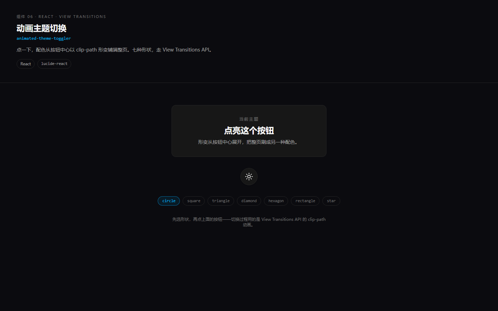
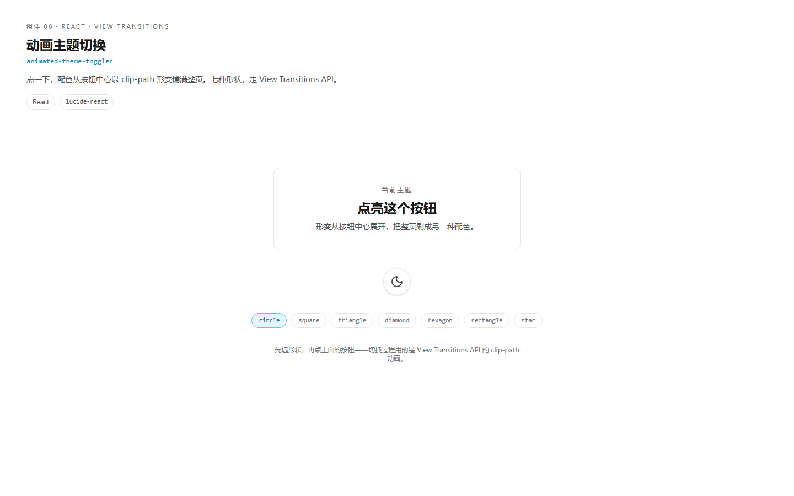

# AnimatedThemeToggler 动画主题切换

> [← 返回组件索引](../../docs/COMPONENTS.md)
> 状态：experimental · 框架：仅 React · 来源：Magic UI · 依赖：`lucide-react`

点一下，新主题从按钮中心以 **clip-path 形变**铺满整个视口——不是淡入淡出，是一块形状"长"出来盖住旧配色。七种形状可选，底层是浏览器原生的 View Transitions API。

## 效果

| 深色 | 浅色 |
| --- | --- |
|  |  |

可交互 demo：`pnpm dev` 后打开 `#/animated-theme-toggler`；截图模式 `?only=animated-theme-toggler`。

动效本身截图看不出来——它发生在点击后的 400ms 里。想验证就把鼠标移到按钮上点一下。

## 安装

```bash
pnpm add @hyjkblj/animated-theme-toggler lucide-react
```

前置条件：

1. 暗色由 `<html class="dark">` 控制（Tailwind v4 里是 `@custom-variant dark (&:where(.dark, .dark *));`）
2. 项目里有 Tailwind——组件内部用了 `sr-only` 做无障碍标签

## 基础用法

```tsx
import { AnimatedThemeToggler } from "@hyjkblj/animated-theme-toggler";

export function Header() {
  return (
    <AnimatedThemeToggler
      variant="star"
      duration={400}
      className="rounded-full border p-3"
    />
  );
}
```

受控用法（主题由 `next-themes` 之类的库管理）：

```tsx
const { theme, setTheme } = useTheme();

<AnimatedThemeToggler
  theme={theme === "dark" ? "dark" : "light"}
  onThemeChange={setTheme}
/>;
```

## API

| 属性 | 类型 | 默认值 | 说明 |
| --- | --- | --- | --- |
| `variant` | `"circle" \| "square" \| "triangle" \| "diamond" \| "hexagon" \| "rectangle" \| "star"` | `"circle"` | 形变的形状 |
| `duration` | `number` | `400` | 动画时长（ms），同时写进 CSS 变量同步 View Transition 组时长 |
| `fromCenter` | `boolean` | `false` | 从视口中心展开，而不是按钮中心 |
| `theme` | `"light" \| "dark"` | `undefined` | 受控值。传了就不写 localStorage，由父组件负责持久化 |
| `onThemeChange` | `(theme: "light" \| "dark") => void` | — | 切换回调，配合 `theme` 使用 |
| `className` | `string` | — | 样式出口。**组件不自带外观**，不传就是浏览器默认按钮 |

其余属性透传到内部 `<button>`（`aria-label`、`disabled`、`title` 等都可以）。

### 渲染内容

`{isDark ? <Sun /> : <Moon />}` 加一个 `sr-only` 的 "Toggle theme" 文本。图标尺寸由 lucide 默认值决定，用 `className="[&_svg]:size-5"` 之类改。

## 样式与主题

没有 CSS 变量，也没有内置样式——外观完全由 `className` 决定：

```tsx
<AnimatedThemeToggler
  className="rounded-full border border-neutral-200 p-3 text-neutral-700
             dark:border-neutral-800 dark:text-neutral-200"
/>
```

主题切换时组件会往 `<html>` 上写三个东西，**不要覆盖**：

| 名字 | 用途 |
| --- | --- |
| `data-magicui-theme-vt="active"` | 标记动画进行中，防止重复触发 |
| `--magicui-theme-toggle-vt-duration` | View Transition 组时长 |
| `--magicui-theme-vt-clip-from` | 起始 clip-path（Firefox 下防闪烁） |

## 注意事项

- **需要 View Transitions API**：Chrome / Edge 111+、Safari 18+ 有；不支持的浏览器会**直接切主题、没有动画**，不会报错。
- **只切换 `<html>` 的 `dark` 类**。它不读 `prefers-color-scheme`，首次访问要靠你自己初始化主题（比如内联脚本读 localStorage）。
- **不受控时会写 `localStorage.theme`，但从不读它**。刷新后主题能否保持，取决于你的初始化脚本——这点容易误以为它自己会记住。
- **没处理 `prefers-reduced-motion`**。对动效敏感的用户也会看到 400ms 的形变，需要的话自己在外面判断后传 `duration={0}`。
- **无障碍名称是英文** `"Toggle theme"`。中文站点建议传 `aria-label="切换主题"` 覆盖。
- **同一时刻只允许一个实例在切换**：组件内部有 `isTransitioningRef` 和 `data-magicui-theme-vt` 双重拦截，连点或两个按钮同时点会被忽略。
- **clip-path 用百分比而非 px**：源码注释说明这是为了规避 Windows 150% 缩放下列表的坐标偏移问题（上游 issue #989）。别为了"更精确"改回 px。
- 依赖 `react-dom` 的 `flushSync`，必须跑在客户端组件里（文件顶部已有 `"use client"`）。

## 变更记录

| 版本 | 变更 |
| --- | --- |
| 0.1.0 | 从 Magic UI 收录，源码原样保留；补 demo 与文档 |

## 出处

- 原组件：Magic UI · [animated-theme-toggler](https://magicui.design/docs/components/animated-theme-toggler)
- 收录方式：源码原样落地（`apps/www/registry/magicui/animated-theme-toggler.tsx`）
- 改动：无（仅在文件头加出处注释）
