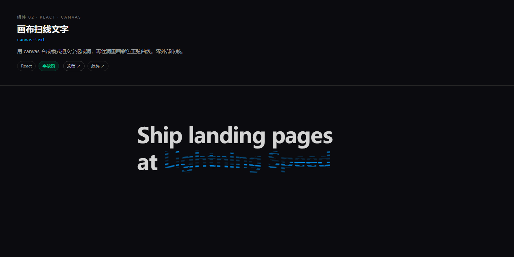

# CanvasText 画布扫线文字

> [← 返回组件索引](../../docs/COMPONENTS.md)
> 状态：experimental · 框架：仅 React · 来源：Aceternity UI · 依赖：无（只需 react 与 `cn`）

把一段文字变成"从彩色扫描线里挖出来的洞"：canvas 用背景色填出字形，再在字形范围内画一层横向贝塞尔曲线，曲线随时间正弦偏移，字就像一扇窗，透过它看见流动的线。

## 效果



可交互 demo：`playground/src/App.tsx`；只想看这一个，用 `?only=canvas-text`。

原理三步（都在同一个 canvas 上，靠合成模式完成）：

1. `source-over` 画黑色文字 → 得到字形
2. `source-in` 用背景色铺满 → 字形外的像素被清掉，字形被"涂成背景色"
3. `source-atop` 画彩色曲线 → 只在字形范围内着色

所以它本质是**用背景色把字抠掉，再往洞里画线**——这也是它最大的坑（见第 7 节第一条）。

## 安装

### 方式一：装包（推荐）

```bash
pnpm add @hyjkblj/canvas-text
```

**Tailwind v4 必看**：类名写在包的 `dist` 里，v4 的自动扫描找不到它，必须在入口 CSS 里显式声明：

```css
@import "tailwindcss";
@source "../node_modules/@hyjkblj";
```

漏了这句，组件会看起来"完全没有样式"。

### 方式二：复制源码


零依赖，只要把文件拷过去：

```bash
cp registry/canvas-text/canvas-text.tsx src/components/ui/
```

只需要 `@/lib/utils` 里的 `cn`（clsx + tailwind-merge）。项目没接 Tailwind 也能用，但要把 `backgroundClassName` 换成自己的普通 className。

## 基础用法

```tsx
import { CanvasText } from "@/components/ui/canvas-text";

export function Hero() {
  return (
    <h1 className="text-6xl font-bold">
      Ship landing pages at{" "}
      <CanvasText
        text="Lightning Speed"
        backgroundClassName="bg-white dark:bg-[#0B0B0F]"
        colors={["rgba(0,153,255,1)", "rgba(0,153,255,0.7)", "rgba(0,153,255,0.4)"]}
        lineGap={4}
        animationDuration={20}
      />
    </h1>
  );
}
```

覆盖到已有文字上（`overlay`）：

```tsx
<span className="relative inline-block">
  <span className="text-neutral-700">Lightning Speed</span>
  <CanvasText text="Lightning Speed" overlay colors={["#38bdf8"]} />
</span>
```

## API

| 属性 | 类型 | 默认值 | 说明 |
| --- | --- | --- | --- |
| `text` | `string` | — | 要画的文字，必填。只画一行 |
| `className` | `string` | `""` | 追加到外层 span |
| `backgroundClassName` | `string` | `"bg-white dark:bg-neutral-950"` | **用它算出的实际背景色去填字形**，必须和真实背景一致 |
| `colors` | `string[]` | 六种糖果色 | 线条颜色，按行循环取用；支持 `var(--x)` |
| `animationDuration` | `number` | `5` | 一次完整波动的周期（秒），越大越慢 |
| `lineWidth` | `number` | `1.5` | 线宽（px） |
| `lineGap` | `number` | `10` | 行距（px），越小线条越密 |
| `curveIntensity` | `number` | `60` | 曲线振幅（px），0 就是直条纹 |
| `overlay` | `boolean` | `false` | 改成 `absolute inset-0`，盖在已有文字上 |

### 无障碍

canvas 上带 `role="img"` 和 `aria-label={text}`，读屏会把它读成一张名为该文字的图片。真正参与排版的文字 span 是 `invisible` + `aria-hidden`。

## 样式与主题

没有 CSS 变量。外观只由三样东西决定：

| 想改的 | 怎么改 |
| --- | --- |
| 字号 / 字重 / 字族 | 让父元素继承即可——组件读的是占位 span 的 computed font |
| 线条颜色 | `colors`，顺序 = 从上往下的行序；想渐变就用一串递进 alpha |
| 线条密度 | `lineGap`（4 很密，10 一般，20 很稀） |
| 线条起伏 | `curveIntensity` + `animationDuration` |
| 背景 | `backgroundClassName`，**必须等于它实际所在区域的背景** |

同色系的蓝（demo 用的那套）：

```tsx
colors={[
  "rgba(0,153,255,1)", "rgba(0,153,255,0.9)", "rgba(0,153,255,0.8)",
  "rgba(0,153,255,0.7)", "rgba(0,153,255,0.6)", "rgba(0,153,255,0.5)",
  "rgba(0,153,255,0.4)", "rgba(0,153,255,0.3)", "rgba(0,153,255,0.2)",
  "rgba(0,153,255,0.1)",
]}
```

## 注意事项

- **`backgroundClassName` 必须是真实背景色**。字形是用"背景色填满"来抠出来的，颜色对不上，文字周围会出现一块明显的色带。深色页就传深色类，别用默认值。
- **每帧都在跑**。一个实例 = 一个常驻 `requestAnimationFrame`，滚出视口也不会停。一屏放三四个就会吃掉不少 CPU，建议配合 `IntersectionObserver` 在外不可见时卸载。
- **只画一行**，没有内置换行和自动宽度。多行拆成多个 `CanvasText`，手动写 `<br />` 或块级换行。
- **字体要早于测量就位**。宽度来自那个 `invisible` 占位 span，webfont 晚到会按 fallback 字体量出尺寸，之后就错位了；自己控制 `font-display: swap` 或在字体加载完成后重挂载。
- **首帧是空的**。测量在 `useEffect` 里做，SSR 或首屏会先看到一块空白，再接上动画。
- **暗色切换会重建颜色**：组件用 `MutationObserver` 盯着 `<html>` 的 class，切主题时会重新解析背景色和 `var()` 颜色，所以别在外面高频改 `<html class>`。
- 它会渲染一个真实的 `<canvas>`，导出 PDF / 打印 / 截图工具不一定能拿到这一层，重要文案别只靠它表达。

## 变更记录

| 版本 | 变更 |
| --- | --- |
| 0.1.0 | 从 Aceternity UI 收录，源码原样保留；补 demo 与文档 |

## 出处

- 原组件：Aceternity UI · [canvas-text](https://ui.aceternity.com/components/canvas-text)
- 收录方式：registry JSON（`https://ui.aceternity.com/registry/canvas-text.json`）原样落地
- 改动：无（仅在文件头加出处注释）
