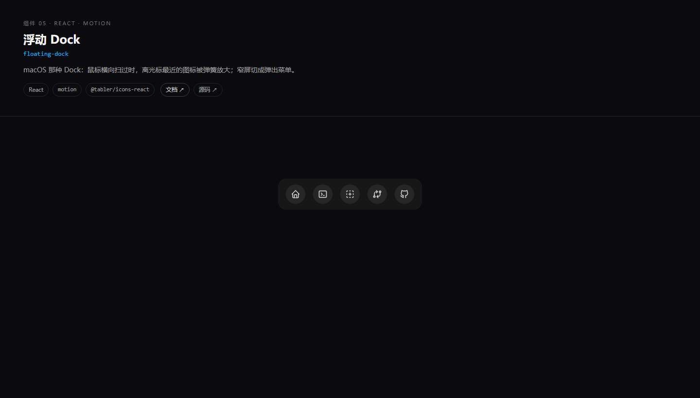

# FloatingDock 浮动 Dock

> [← 返回组件索引](../../docs/COMPONENTS.md)
> 状态：experimental · 框架：仅 React · 来源：Aceternity UI · 依赖：`motion`、`@tabler/icons-react`

macOS 那种 Dock：一排圆形图标，鼠标横向扫过去时，离光标最近的图标被弹簧放大，远的回落原尺寸。窄屏自动变成右下角一个圆按钮，点开向上弹出图标列表。

## 效果



可交互 demo：`pnpm dev` 后打开 `#/floating-dock`，鼠标横向扫过图标；截图模式 `?only=floating-dock`。

> 静态图只有静止状态——放大效果要鼠标扫过才看得到。

## 安装

### 方式一：装包（推荐）

```bash
pnpm add @hyjkblj/floating-dock
```

（会一并装上 `motion @tabler/icons-react`；它们是 peerDependency，装过一次就够）

**Tailwind v4 必看**：类名写在包的 `dist` 里，v4 的自动扫描找不到它，必须在入口 CSS 里显式声明：

```css
@import "tailwindcss";
@source "../node_modules/@hyjkblj";
```

漏了这句，组件会看起来"完全没有样式"。

### 方式二：复制源码


```bash
pnpm add motion @tabler/icons-react
cp registry/floating-dock/floating-dock.tsx src/components/ui/
```

需要 `@/lib/utils` 的 `cn` 和 Tailwind。

## 基础用法

```tsx
import { FloatingDock } from "@/components/ui/floating-dock";
import { IconBrandGithub, IconHome, IconTerminal2 } from "@tabler/icons-react";

const items = [
  { title: "首页", href: "/", icon: <IconHome className="h-full w-full" /> },
  { title: "组件", href: "/components", icon: <IconTerminal2 className="h-full w-full" /> },
  { title: "GitHub", href: "https://github.com", icon: <IconBrandGithub className="h-full w-full" /> },
];

<FloatingDock items={items} desktopClassName="fixed bottom-6 left-1/2 -translate-x-1/2" />;
```

## API

| 属性 | 类型 | 默认值 | 说明 |
| --- | --- | --- | --- |
| `items` | `{ title: string; icon: ReactNode; href: string }[]` | — | **`title` 必须唯一**（被用作 key 和 React key），也是 hover tooltip 的文字 |
| `desktopClassName` | `string` | `""` | 追加到桌面版容器（`mx-auto hidden h-16 items-end gap-4 rounded-2xl bg-gray-50 px-4 pb-3 md:flex`） |
| `mobileClassName` | `string` | `""` | 追加到移动版容器（`relative block md:hidden`） |

### 内部结构

| 子组件 | 说明 |
| --- | --- |
| `FloatingDockDesktop` | `md` 以上显示。`useMotionValue(pageX)` 驱动整排图标联动 |
| `FloatingDockMobile` | `md` 以下显示。一个圆按钮 + 点击向上弹出的列表 |
| `IconContainer` | 单个图标：距离 → 尺寸 → 弹簧 |

放大曲线（改这些数字就是改手感）：

```ts
distance = mouseX - (元素左边界 + 元素宽度 / 2)   // 光标到图标中心的像素距离
容器尺寸: [-150, 0, 150] → [40, 80, 40]
图标尺寸: [-150, 0, 150] → [20, 40, 20]
弹簧参数: { mass: 0.1, stiffness: 150, damping: 12 }
```

## 样式与主题

没有 CSS 变量，全部是 Tailwind 类：

| 想改的 | 怎么改 |
| --- | --- |
| Dock 底色 / 圆角 / 内边距 | 覆盖 `bg-gray-50 dark:bg-neutral-900`、`rounded-2xl`、`px-4 pb-3` |
| 图标间距 | `gap-4` |
| 放大倍数 | 改 `[40, 80, 40]`（容器）与 `[20, 40, 20]`（图标） |
| 放大的影响范围 | 改 `[-150, 0, 150]`，绝对值越大影响越远、越平缓 |
| 弹簧手感 | 改 `mass / stiffness / damping`；`stiffness` 大＝更跟手 |
| tooltip 样式 | 那一串 `-top-8 rounded-md border bg-gray-100 px-2 py-0.5 text-xs` |
| 图标颜色 | 由你传的 `icon` 自己决定（默认继承文字色） |

## 注意事项

- **图标要写 `h-full w-full`**。尺寸由外层 `motion.div` 控制（20→40px），你的 SVG 不撑满就不会跟着放大。
- **坐标系用的是 `e.pageX` 对比 `getBoundingClientRect().x`**。纵向滚动不影响，但**页面横向滚动时两者会错位**，放大中心会跑偏。Dock 固定在底部时正常，嵌在横向滚动容器里就会出问题。
- **放大后图标会顶出 Dock 上沿**。容器是固定 `h-16` + `items-end`，图标从 40px 长到 80px 只能向上溢出——这是设计意图，但别在 Dock 上面压别的内容，会打架。
- **移动版和桌面版是两个独立组件**，靠 `md:flex` / `md:hidden` 切换，没有 JS 判断宽度，所以 SSR 不会闪。代价是两套 DOM 都渲染在树里。
- **一个页面只能放一个**：移动版用了共享的 `layoutId="nav"`，渲染两个实例时展开动画会互相抢。
- **`items` 的 `title` 必须唯一**，重复会导致 React key 冲突 + tooltip 串位。
- **无障碍基本为零**：移动版的打开按钮没有 `aria-label`，图标链接只有可见的 tooltip，屏幕阅读器读不到名称。自己补 `aria-label`。
- 组件里的 `<a>` 没处理 `target`/`rel`，外链要自己加。

## 变更记录

| 版本 | 变更 |
| --- | --- |
| 0.1.0 | 从 Aceternity UI 收录，源码原样保留；补 demo 与文档 |

## 出处

- 原组件：Aceternity UI · [floating-dock](https://ui.aceternity.com/components/floating-dock)
- 收录方式：registry JSON（`https://ui.aceternity.com/registry/floating-dock.json`）原样落地
- 改动：无（仅在文件头加出处注释）
