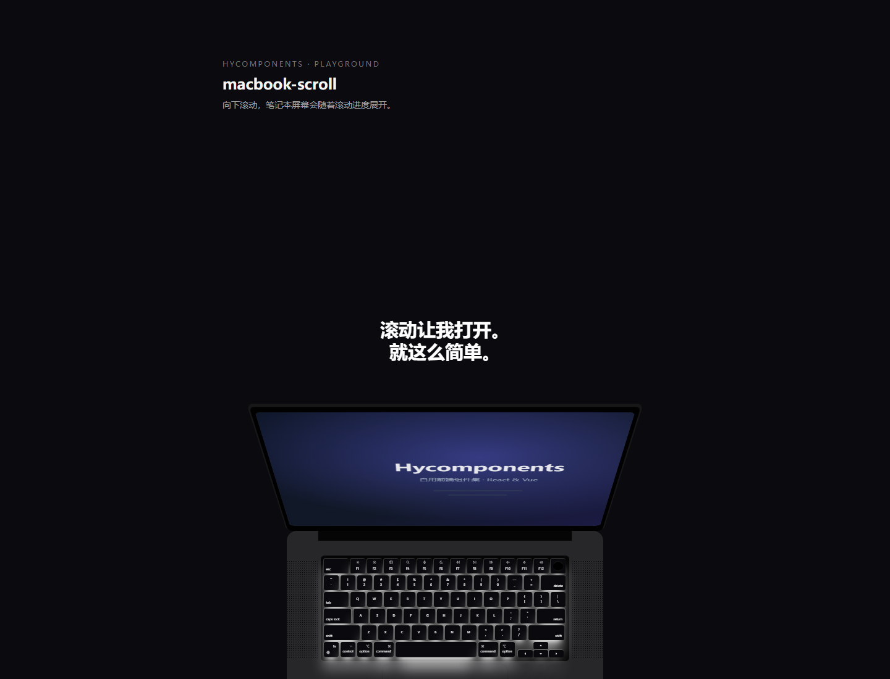

# MacbookScroll 笔记本滚动展开

> 状态：experimental · 框架：仅 React · 来源：Aceternity UI · 依赖：`motion`、`@tabler/icons-react`

页面往下滚，一台 MacBook 从合盖倾斜的状态慢慢"开盖"转正，屏幕里的内容随之展开。用来做首屏到正文的过渡，或者单纯放一张产品截图装个样子。

## 效果



可交互 demo：`playground/src/App.tsx`。`pnpm dev` 后打开首页向下滚动；想看某个中间状态，用 `http://localhost:5173/?scroll=520` 直接跳到对应滚动位置。

三个阶段：

| 滚动进度 | 屏幕状态 |
| --- | --- |
| 0 → 0.1 | 起始态：`rotateX(-28deg)`，屏幕压扁（scaleY 0.6） |
| 0.1 → 0.3 | 开盖：旋转归 0，屏幕放大到 1.5 倍 |
| 0 → 1 | 整体上移 1500px，标题上移并淡出 |

## 安装

### 方式一：装包（推荐）

```bash
pnpm add @hyjkblj/macbook-scroll
```

（会一并装上 `motion @tabler/icons-react`；它们是 peerDependency，装过一次就够）

**Tailwind v4 必看**：类名写在包的 `dist` 里，v4 的自动扫描找不到它，必须在入口 CSS 里显式声明：

```css
@import "tailwindcss";
@source "../node_modules/@hyjkblj";
```

漏了这句，组件会看起来"完全没有样式"。

### 方式二：复制源码


依赖 Tailwind CSS、`motion`、`@tabler/icons-react`，以及 shadcn 惯例的 `cn()`：

```bash
pnpm add motion @tabler/icons-react clsx tailwind-merge
```

把 `macbook-scroll.tsx` 复制到你的组件目录（例如 `src/components/ui/`），并确认：

- `@/lib/utils` 里导出了 `cn`
- 项目已接好 Tailwind

## 基础用法

```tsx
import { MacbookScroll } from "@/components/ui/macbook-scroll";

export function Hero() {
  return (
    <div className="w-full overflow-hidden bg-white dark:bg-[#0B0B0F]">
      <MacbookScroll
        title={<span>这台笔记本是滚出来的。</span>}
        src="/screen.png"
        showGradient={false}
      />
    </div>
  );
}
```

带角标：

```tsx
<MacbookScroll
  src="/screen.png"
  badge={}
/>
```

## API

### Props

| 属性 | 类型 | 默认值 | 说明 |
| --- | --- | --- | --- |
| `src` | `string` | 内置示例图 | 屏幕里显示的内容，建议 16:10 的截图 |
| `title` | `string \| ReactNode` | 内置文案 | 笔记本上方的标题，随滚动上移淡出 |
| `badge` | `ReactNode` | `undefined` | 左上角的角标，通常放 logo |
| `showGradient` | `boolean` | `true` | 笔电下方的渐变光晕 |

### 内部导出（可复用，但属于内部件）

`Lid`、`Trackpad`、`Keypad`、`KBtn`、`SpeakerGrid`、`OptionKey`。
改键盘外观时才会碰它们，正常使用不要直接调。

## 样式与主题

这个组件**没有 CSS 变量**，外观全部由 Tailwind 类写死，改法有两种：

| 想改的 | 怎么改 |
| --- | --- |
| 底座颜色 | 找 `bg-gray-200 dark:bg-[#272729]`，换掉 |
| 屏幕黑边宽度 | `Lid` 里的 `bg-neutral-800` 一圈 border，调 padding |
| 整体尺寸 | 根节点 `scale-[0.35] sm:scale-50 md:scale-100`，三档断点 |
| 滚动行程 | 根节点 `min-h-[200vh]`，改小动效会变快 |
| 开盖角度 | `useTransform(scrollYProgress, [0.1, 0.12, 0.3], [-28, -28, 0])` 里的 `-28` |

暗色主题走 `dark:` 变体，需要项目里开关生效（Tailwind v4 需自行声明 `@custom-variant dark`，本仓库的 playground 用 `.dark` 类）。

## 注意事项

- **只支持 React**，没有 Vue 版。要在 Vue 项目里用，得自己移植 `useScroll` / `useTransform` 对应的逻辑。
- **必须有 Tailwind**，它不是纯 CSS 组件，拷到一个没有 Tailwind 的项目里会彻底变形。
- **Tailwind v4 要显式声明扫描范围**：源码放在 build 根目录之外时，v4 的自动扫描找不到它，类名会全部失效（表现为图片铺满整屏）。在入口 CSS 里加 `@source "../../registry";` 这类路径声明。本仓库就是这样修的。
- **滚动目标是自己**：`useScroll({ target: ref })` 绑在组件根节点上，所以它必须放在**整页滚动**的位置。放进一个 `overflow: auto` 的小容器里，动效不会触发。
- **占高 200vh**，不适合塞进首屏以下的卡片区；一个页面里也别放两个以上，滚动进度会互相打架。
- 移动端宽度 < 768px 时自动改成 `scale-[0.35]`，字号会偏小，标题建议控制在 10 个字以内。
- 首帧会有一次 `useEffect` 判断宽度，SSR 下首屏渲染用的是桌面端参数，水合后可能跳一下。
- 依赖 `motion`（framer-motion 的改名版）约 40KB gzip（按需 tree-shake 后会小一些），纯静态页面不值得为它引。

## 变更记录

| 版本 | 变更 |
| --- | --- |
| 0.1.0 | 从 Aceternity UI 收录，源码原样保留；补 demo 与文档 |

## 出处

- 原组件：Aceternity UI · [macbook-scroll](https://ui.aceternity.com/components/macbook-scroll)
- 收录方式：registry JSON（`https://ui.aceternity.com/registry/macbook-scroll.json`）原样落地
- 改动：无（仅在文件头加出处注释）
