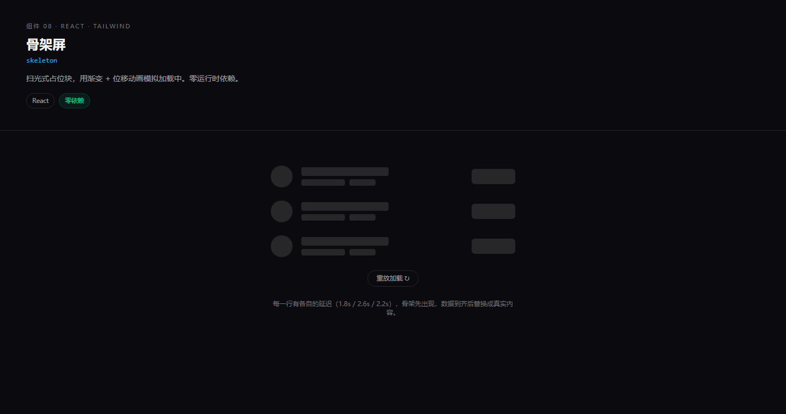

# Skeleton 骨架屏

> [← 返回组件索引](../../docs/COMPONENTS.md)
> 状态：experimental · 框架：仅 React · 来源：Coss UI · 依赖：无（需 Tailwind v4 主题变量）

加载中的占位块：一块 `--color-muted` 底色上，一条高光从左往右扫。比常见的 `animate-pulse` 更"有方向感"，视觉上更像真的在取数据。

## 效果



可交互 demo：`pnpm dev` 后打开 `#/skeleton`；截图模式 `?only=skeleton`。

> 静图只能看到骨架的尺寸和排布——扫光是 CSS 动画，抓帧抓不到，得打开页面看。

Demo 里三行有各自的延迟（1.8s / 2.6s / 2.2s），骨架先出现，数据到齐后替换成真实内容——底部「重放加载」可重来一次。

## 安装

组件本身零依赖，但它**依赖三个 CSS 片段**，装的时候要一起带上：

```css
@import "tailwindcss";

@theme {
  --color-muted: #f4f4f5;                              /* 骨架底色 */
  --animate-skeleton: skeleton 2s -1s infinite linear; /* 扫光动画 */
}

@keyframes skeleton {
  to {
    background-position: -200% 0;
  }
}

/* 暗色下换个底色 */
html.dark {
  --color-muted: #27272a;
}
```

用 `npx shadcn@latest add @coss/skeleton` 安装时，这些会自动写进你的 globals.css（registry 的 `cssVars` / `css` 字段）；手动拷源码的话要自己贴。

```bash
pnpm add @hyjkblj/skeleton
```

## 基础用法

```tsx
import { Skeleton } from "@hyjkblj/skeleton";

export function CardSkeleton() {
  return (
    <div className="flex items-center gap-4">
      <Skeleton className="size-10 rounded-full" />
      <div className="flex flex-1 flex-col gap-2">
        <Skeleton className="h-4 w-40" />
        <Skeleton className="h-3 w-24" />
      </div>
    </div>
  );
}
```

配合加载状态：

```tsx
function UserRow({ user }: { user?: User }) {
  if (!user) {
    return (
      <div className="flex items-center gap-4">
        <Skeleton className="size-10 rounded-full" />
        <Skeleton className="h-4 w-40" />
      </div>
    );
  }
  return <RealRow user={user} />;
}
```

## API

只有一个组件，没有别的 props：

| 属性 | 类型 | 默认值 | 说明 |
| --- | --- | --- | --- |
| `className` | `string` | — | **必传尺寸**：宽度、高度、圆角都靠它 |
| `...props` | `React.ComponentProps<"div">` | — | 透传到内部 `<div>` |

渲染结果：

```html
<div data-slot="skeleton" class="animate-skeleton rounded-sm [background:...]" />
```

## 样式与主题

| 想改的 | 怎么改 |
| --- | --- |
| 底色 | 覆盖 `--color-muted`（或在 `className` 里写 `bg-*`） |
| 扫光颜色 | 组件用 `--skeleton-highlight`，暗色下是 `white/4%`、亮色下 `white/64%`；在 `className` 里覆盖这个变量 |
| 速度 | `--animate-skeleton` 里的 `2s` |
| 圆角 | 默认 `rounded-sm`，传 `className="rounded-full"` 覆盖 |
| 高光方向 | 背景渐变角度写在类里（`120deg`），要改得动源码 |

## 注意事项

- **不传尺寸就什么都不显示**。它是 `<div>`，没有默认宽高，`<Skeleton />` 单独用是 0×0。
- **必须有 `--color-muted` 和 `--animate-skeleton`**。缺前者整块是透明的，缺后者就是一块死板的灰块——两种失败都很难一眼看出原因。
- **`-1s` 的负延迟是有意的**：让动画一开始就处在中间相位，不会"加载出来先静止一秒再开始扫"。
- **无障碍基本没做**。它是纯装饰元素，但组件没有 `aria-hidden`。建议外层加 `role="status" aria-busy="true"`，再放一个 `sr-only` 的「加载中」。
- **不响应 `prefers-reduced-motion`**。对动效敏感的用户会一直看到扫光，介意的话自己在 CSS 里加一条媒体查询把它关掉。
- **暗色切换靠 `html.dark`**，与本仓库其余组件一致；如果你的暗色策略是 `media`，要把那条 `html.dark` 改成 `@media (prefers-color-scheme: dark)`。
- 用 `data-slot="skeleton"` 可以做统一选择器，比如 `[data-slot="skeleton"] { border-radius: 999px }`。

## 变更记录

| 版本 | 变更 |
| --- | --- |
| 0.1.0 | 从 Coss UI 收录；导入路径改为 `@/lib/utils`；补 demo 与文档 |

## 出处

- 原组件：Coss UI · [skeleton](https://coss.com/ui/r/skeleton.json)
- 收录方式：registry JSON 原样落地
- 改动：**HY-MODIFIED** —— 导入路径 `@/registry/default/lib/utils` → `@/lib/utils`
