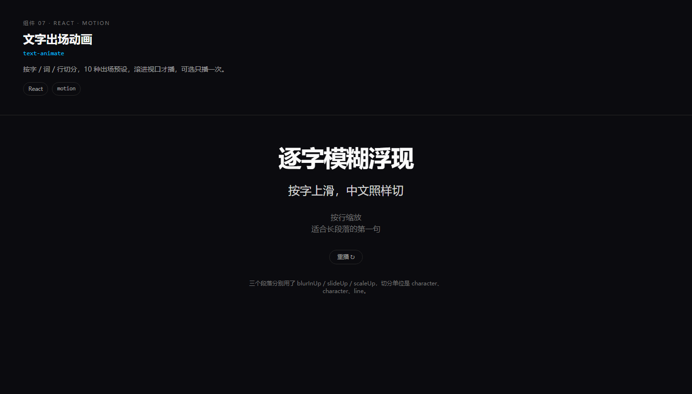

# TextAnimate 文字出场动画

> [← 返回组件索引](../../docs/COMPONENTS.md)
> 状态：experimental · 框架：仅 React · 来源：Magic UI · 依赖：`motion`

把一段文字按 **字 / 词 / 行** 切开，逐段做入场动画。10 种预设（模糊、位移、缩放），滚进视口才播，可以设成只播一次。

## 效果



可交互 demo：`pnpm dev` 后打开 `#/text-animate`；截图模式 `?only=text-animate`。

Demo 里三段分别是：`blurInUp` + 按字、`slideUp` + 按字、`scaleUp` + 按行。底部有「重播」按钮。

## 安装

```bash
pnpm add @hyjkblj/text-animate motion
```

## 基础用法

```tsx
import { TextAnimate } from "@hyjkblj/text-animate";

export function Hero() {
  return (
    <TextAnimate animation="blurInUp" by="character" once>
      逐字模糊浮现
    </TextAnimate>
  );
}
```

换元素与自定义变体：

```tsx
<TextAnimate as="h1" by="word" animation="slideUp" delay={0.2}>
  Ship faster
</TextAnimate>

// 或者完全不预设，自己给 motion variants
<TextAnimate
  variants={{
    hidden: { opacity: 0, y: 20 },
    show: { opacity: 1, y: 0 },
  }}
>
  自定义
</TextAnimate>
```

## API

| 属性 | 类型 | 默认值 | 说明 |
| --- | --- | --- | --- |
| `children` | `string` | — | **只接受字符串**，不接受 ReactNode |
| `by` | `"word" \| "text" \| "character" \| "line"` | `"word"` | 切分单位 |
| `animation` | `AnimationVariant` | `"fadeIn"` | 10 种预设，见下表 |
| `duration` | `number` | `0.3` | **整段动画的总时长**（秒），不是单段 |
| `delay` | `number` | `0` | 整体延迟（秒） |
| `startOnView` | `boolean` | `true` | 滚进视口才播；设 `false` 则挂载即播 |
| `once` | `boolean` | `false` | 只播一次；`false` 时每次滚入都重播 |
| `as` | `"p" \| "span" \| "div" \| "h1"…"h6" \| "li" \| "article" \| "section"` | `"p"` | 渲染的元素 |
| `className` | `string` | — | 容器类名（默认带 `whitespace-pre-wrap`） |
| `segmentClassName` | `string` | — | 追加到**每一段**上 |
| `variants` | `Variants` | — | 自定义 motion variants，传了就不走 `animation` 预设 |
| `accessible` | `boolean` | `true` | 见下方「无障碍」 |

其余 motion 属性（`transition`、`whileHover` 等）透传给容器。

### 10 种预设

| 名字 | 效果 |
| --- | --- |
| `fadeIn` | 淡入 |
| `blurIn` / `blurInUp` / `blurInDown` | 模糊淡入，带向上 / 向下位移 |
| `slideUp` / `slideDown` / `slideLeft` / `slideRight` | 从对应方向滑入 |
| `scaleUp` / `scaleDown` | 缩放进入（弹簧） |

### 无障碍

`accessible` 为 `true`（默认）时：

- 容器上挂 `aria-label={children}`
- 额外渲染一个 `sr-only` 的完整文本
- 所有分段 `aria-hidden`

结果：读屏软件读一遍完整句子，而不是把每个字当独立元素念。

## 样式与主题

没有 CSS 变量。容器默认 `whitespace-pre-wrap`，分段默认 `inline-block whitespace-pre`（`by="line"` 时是 `block`）。

想改字号颜色就传 `className`；想让某一段特别一点，用 `segmentClassName`——但它作用于**所有**段，做不了"最后一个词变蓝"，那种要自己改源码。

## 注意事项

- **`duration` 是总时长，不是每段时长**。源码里 `staggerChildren = duration / segments.length`：40 个字配 0.3s，每个字只有 7.5ms 间隔，看起来像"唰"一下全出来。想让单字可见，字数越多 `duration` 要越大。
- **`by="word"` 按空白切分**（`split(/(\s+)/)`）。中文没有空格 → 整句就是一个 segment，逐词动画等于没效果。**中文一律用 `by="character"`**。
- **`by="line"` 只认 `\n`**。别指望它按视觉换行切——浏览器自动折行的地方它看不见，必须自己在字符串里写换行符。
- **`children` 只能是字符串**。想塞 `<em>` 之类的富文本不行，得拆成多个组件。
- **`once=false`（默认）会重播**：滚出视口再滚回来就再演一次。首屏大标题建议显式写 `once`。
- **切分后每段都是独立 `<span>`**。40 个字就是 40 个 DOM 节点，长段落（几百字）会明显增加节点数和动画开销，长文不要整段用它。
- 组件用 `memo` 包装，但 `variants` / `children` 传字面量对象时每次渲染都是新引用，父组件频繁重渲染会让 memo 失效。

## 变更记录

| 版本 | 变更 |
| --- | --- |
| 0.1.0 | 从 Magic UI 收录，源码原样保留；补 demo 与文档 |

## 出处

- 原组件：Magic UI · [text-animate](https://magicui.design/docs/components/text-animate)
- 收录方式：源码原样落地（`apps/www/registry/magicui/text-animate.tsx`）
- 改动：无（仅在文件头加出处注释）
