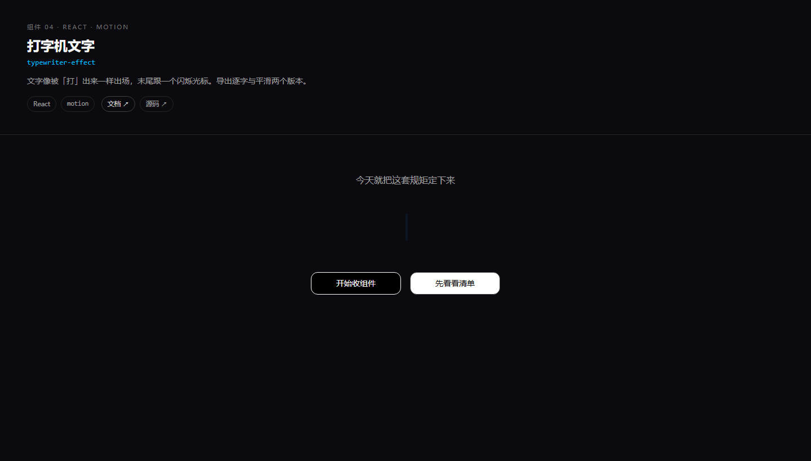

# TypewriterEffect 打字机文字

> [← 返回组件索引](../../docs/COMPONENTS.md)
> 状态：experimental · 框架：仅 React · 来源：Aceternity UI · 依赖：`motion`

一段文字像被"打"出来一样逐字出场，末尾跟一个闪烁光标。组件导出两个版本，动画机制完全不同，选错会很别扭。

## 效果



可交互 demo：`pnpm dev` 后打开 `#/typewriter-effect`；截图模式 `?only=typewriter-effect`。

## 安装

### 方式一：装包（推荐）

```bash
pnpm add @hyjkblj/typewriter-effect
```

（会一并装上 `motion`；它们是 peerDependency，装过一次就够）

**Tailwind v4 必看**：类名写在包的 `dist` 里，v4 的自动扫描找不到它，必须在入口 CSS 里显式声明：

```css
@import "tailwindcss";
@source "../node_modules/@hyjkblj";
```

漏了这句，组件会看起来"完全没有样式"。

### 方式二：复制源码


```bash
pnpm add motion
cp registry/typewriter-effect/typewriter-effect.tsx src/components/ui/
```

需要 `@/lib/utils` 的 `cn`，以及 Tailwind。

## 两个版本，先选对再写代码

| | `TypewriterEffect` | `TypewriterEffectSmooth` |
| --- | --- | --- |
| 机制 | 每个字符 `opacity/width` 逐字动画（`useAnimate` + `stagger(0.1)`） | 外层容器 `width: 0 → fit-content` 的一次性擦除（`whileInView`） |
| 观感 | 真·打字，一个字一个字蹦 | 匀速"刷"出来，没有停顿 |
| 时长 | 0.3s × 字符数 | 固定 2s |
| 适合 | 短句、有力度的标语 | 长一点的标题 |

**默认拿到的 demo 用的是 Smooth**，需要真打字感就换另一个。

## 基础用法

```tsx
import { TypewriterEffectSmooth } from "@/components/ui/typewriter-effect";

const words = [
  { text: "Build" },
  { text: "awesome" },
  { text: "apps" },
  { text: "with" },
  { text: "Aceternity.", className: "text-blue-500 dark:text-blue-500" },
];

export function Hero() {
  return <TypewriterEffectSmooth words={words} />;
}
```

逐字版本：

```tsx
import { TypewriterEffect } from "@/components/ui/typewriter-effect";

<TypewriterEffect words={words} cursorClassName="bg-emerald-500" />;
```

## API

两个组件签名一致：

| 属性 | 类型 | 默认值 | 说明 |
| --- | --- | --- | --- |
| `words` | `{ text: string; className?: string }[]` | — | 按词切分，每个词的 `className` 只作用于该词的字符 |
| `className` | `string` | `""` | 追加到最外层容器 |
| `cursorClassName` | `string` | `""` | 追加到光标（默认 `bg-blue-500`，宽 4px，高度按断点 h-4 / sm:h-6 / xl:h-12） |

没有速度、时长、循环次数、起始延迟这些 props——**都是写死的**，要调只能改源码：

| 想改的 | 改哪里 |
| --- | --- |
| Smooth 的擦除速度 / 延迟 | `transition: { duration: 2, ease: "linear", delay: 1 }` |
| 逐字版本的每字时长 / 间隔 | `duration: 0.3` 与 `stagger(0.1)` |
| 光标闪烁频率 | `transition: { duration: 0.8, repeat: Infinity }` |
| 字号 | 内层写死的 `text-xs sm:text-base md:text-xl xl:text-5xl` |

## 样式与主题

没有 CSS 变量。字号和字重写死在组件内部（`font-bold`），颜色默认 `text-black dark:text-white`，靠 `word.className` 局部覆盖。

改字号只能覆盖那串类名，或者在外面套一层并调自己的字号——但内层的显式 `text-*` 会赢，所以实际做法是改源码里那一行。

## 注意事项

- **暗色模式下 `word.className` 里的颜色不生效**。源码是 `cn("dark:text-white text-black", word.className)`——`dark:text-white` 是带变体的类，优先级高于你传的 `text-blue-500`。这就是为什么 demo 里最后一个词设了 `text-blue-500` 却还是白的。**要传 `dark:text-blue-500` 才行**。
- **每个词后面强制加了 `&nbsp;`**。中文本来不用空格，结果词与词之间会多出一段空隙（截图里"收进来 就 写清楚 别 欠账。"的间距就是这么来的）。介意的话把 `words` 拆成整句一个词，或者改源码去掉。
- **`whiteSpace: "nowrap"`**：不会换行。句子长了会在容器里溢出，移动端尤其明显，自己在外面加宽度限制或换行策略。
- **字号类名里有个笔误**：`lg:text:3xl`（多了个冒号，是无效类名），所以 lg 断点实际用的是 `md:text-xl`，到 xl 才变 `text-5xl`。想修就在源码里改成 `lg:text-3xl`——但收录原则是先原样保留，改不改由你定。
- **触发条件不同**：Smooth 用 `whileInView`，滚出视口再滚回来会**重播**；逐字版用 `useInView` + `useEffect`，播放后不会自己重置。做首屏时注意这个差别。
- **固定 1 秒延迟**：Smooth 有 `delay: 1`，放在页面顶部会觉得"卡了一下"才动。首屏用建议先在源码里调小。
- 文字是真实 DOM 文本（不是 canvas），可选中、可复制、能被搜索到，这点比 canvas 类组件友好。

## 变更记录

| 版本 | 变更 |
| --- | --- |
| 0.1.0 | 从 Aceternity UI 收录，源码原样保留；补 demo 与文档 |

## 出处

- 原组件：Aceternity UI · [typewriter-effect](https://ui.aceternity.com/components/typewriter-effect)
- 收录方式：registry JSON（`https://ui.aceternity.com/registry/typewriter-effect.json`）原样落地
- 改动：无（仅在文件头加出处注释）
