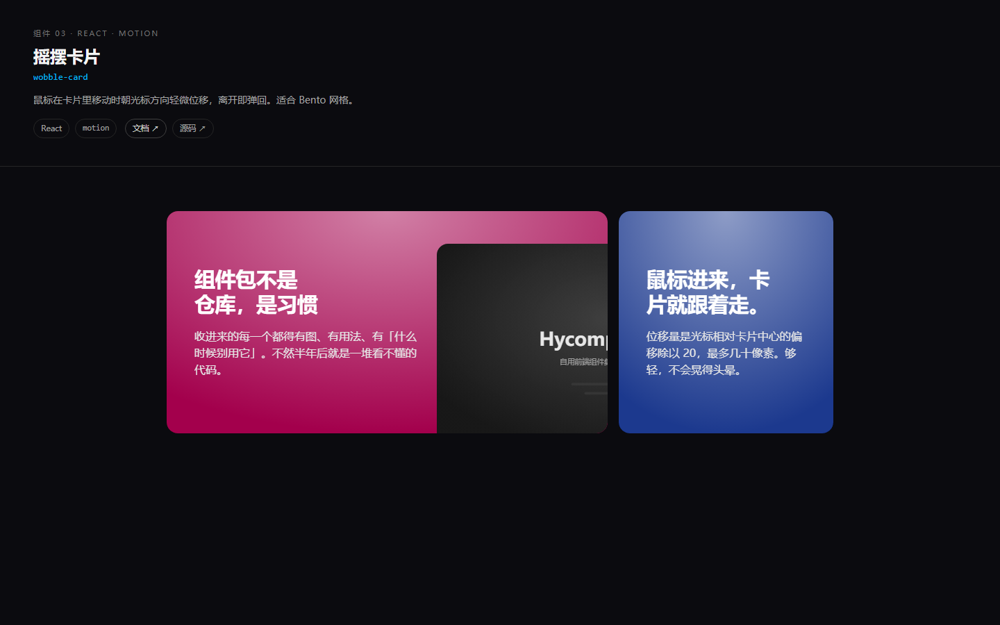

# WobbleCard 摇摆卡片

> [← 返回组件索引](../../README.md#组件文档索引)
> 状态：experimental · 框架：仅 React · 来源：Aceternity UI · 依赖：`motion`（其实可以拆掉，见注意事项）

一张会跟着鼠标轻微位移的卡片：光标在卡片里移动时，卡片朝光标方向偏一点点，鼠标离开就弹回原位。位移只有几十像素，做信息卡片、推荐位、Bento 网格的那种"活的"感觉。

## 效果



可交互 demo：`playground/src/App.tsx`，或 `?only=wobble-card`。

> 静态图只能看到排版——位移是交互效果，把鼠标放上去才看得出来。

## 安装

### 方式一：装包（推荐）

```bash
pnpm add @hyjkblj/wobble-card
```

（会一并装上 `motion`；它们是 peerDependency，装过一次就够）

**Tailwind v4 必看**：类名写在包的 `dist` 里，v4 的自动扫描找不到它，必须在入口 CSS 里显式声明：

```css
@import "tailwindcss";
@source "../node_modules/@hyjkblj";
```

漏了这句，组件会看起来"完全没有样式"。

### 方式二：复制源码


```bash
pnpm add motion
cp registry/wobble-card/wobble-card.tsx src/components/ui/
```

需要 `@/lib/utils` 的 `cn`，以及 Tailwind。

## 基础用法

```tsx
import { WobbleCard } from "@/components/ui/wobble-card";

export function Cards() {
  return (
    <div className="grid grid-cols-1 gap-4 lg:grid-cols-3">
      <WobbleCard containerClassName="col-span-1 min-h-[300px] bg-pink-800 lg:col-span-2">
        <h2 className="max-w-xs text-3xl font-semibold text-white">标题</h2>
        <p className="mt-4 text-base text-neutral-200">正文。</p>
        
      </WobbleCard>

      <WobbleCard containerClassName="min-h-[300px] bg-blue-900">
        <h2 className="text-3xl font-semibold text-white">另一张</h2>
      </WobbleCard>
    </div>
  );
}
```

## API

| 属性 | 类型 | 默认值 | 说明 |
| --- | --- | --- | --- |
| `children` | `ReactNode` | — | 卡片内容，直接放在卡片内，可用 `absolute` 定位装饰图 |
| `containerClassName` | `string` | `""` | **主要出口**：背景色、尺寸、网格跨度都从这里传 |
| `className` | `string` | `""` | 追加到内层内容容器 |

组件根节点是 `<section>`，默认类名 `mx-auto w-full bg-indigo-800 relative rounded-2xl overflow-hidden`——不传 `containerClassName` 就是一块靛蓝色空白方块。

### 事件

没有对外抛的事件。鼠标交互全在组件内部完成（`onMouseMove` / `onMouseEnter` / `onMouseLeave`）。

## 样式与主题

没有 CSS 变量，全部走 Tailwind 类：

| 想改的 | 怎么改 |
| --- | --- |
| 背景色 | `containerClassName="bg-pink-800"` |
| 圆角 | 默认 `rounded-2xl`，传 `containerClassName="rounded-3xl"` 覆盖（twMerge 会处理） |
| 顶部高光 | 内层那层 `radial-gradient` 是硬编码的 `[background-image:...]`，想去掉得改源码 |
| 位移幅度 | 源码里 `/ 20`，改大变小；也可以改成读 CSS 变量 |
| 跟手速度 | `transition: "transform 0.1s ease-out"`，调大更"拖沓"，调小更跟手 |

## 注意事项

- **只对鼠标有效**。靠 `onMouseMove` 触发，触屏设备没有 hover，移动端就是一张静态卡片——别把关键信息藏在"会动"这件事上。
- **`motion` 这个依赖是可以拆掉的**。源码只用到了 `motion.section` 这层壳，没用到任何 motion 的 props（`style` 里就是普通 `transform`）。换成 `<section>` 功能完全不变，能省一份依赖——收录时先原样保留，用不用拆由项目自己决定。
- **每次 mousemove 都 `setState`**。React 里这是高频重渲染源头，一屏放十张卡就会掉帧。要么控制数量，要么自己改成 `useRef` + 直接写 `element.style.transform`。
- **`transform` 会创建新的包含块**：卡片内的 `position: fixed` 子元素会失效，`absolute` 子元素会跟着卡片一起偏移（官方 demo 正是靠这个让装饰图跟着晃）。
- **默认 `overflow-hidden`**：超出卡片的装饰图会被裁掉。官方 demo 用 `-right-[40%]` 故意压边，就是在这个裁剪里做构图——想让它出界得改结构。
- 位移量是「光标相对卡片中心的偏移 ÷ 20」：卡片越宽，同样的鼠标位置偏移越大，大卡片会显得比小卡片晃得厉害。要做一套视觉统一的网格，按卡片尺寸给不同的除数。

## 变更记录

| 版本 | 变更 |
| --- | --- |
| 0.1.0 | 从 Aceternity UI 收录，源码原样保留；补 demo 与文档 |

## 出处

- 原组件：Aceternity UI · [wobble-card](https://ui.aceternity.com/components/wobble-card)
- 收录方式：registry JSON（`https://ui.aceternity.com/registry/wobble-card.json`）原样落地
- 改动：无（仅在文件头加出处注释）
